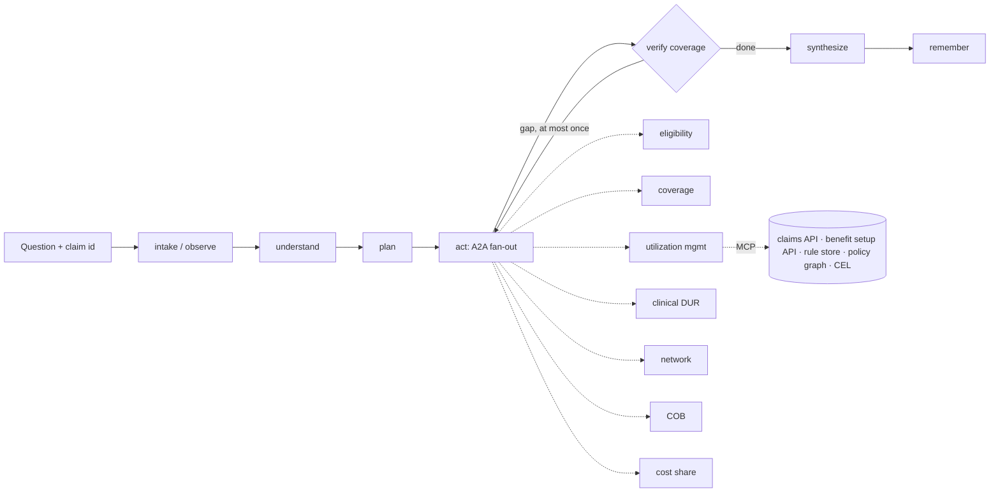

# Madhava agent system: planner, domain agents, memory and the rules/policy graph

> **v0.2 note (kernel split).** The code described here now lives in three places: the SDK-neutral `rulegraph` kernel (`kernel/`), the pharmacy domain agents package ([madhava-ai-subagent](https://github.com/Satveerskhaira/madhava-ai-subagent): knowledge pack, claim adapter, fixtures) and the core agent (`src/madhava/`). Changes from what follows:
> - Every domain agent is now a **planner** (same loop as the core: understand, plan, act, verify with its own bounded gap round, synthesize) scoped to its taxonomy branch, over rule-domain **investigators** that run the fixed playbook described below.
> - Core to domain agents is **in process** (the core imports the package). A2A is used only to expose the core (`madhava serve`). `serve-agents` and `--a2a-base-port` are gone.
> - Paths: `knowledge/` is now `pharmacy_agents/pack/`; `src/madhava/agents|memory|rules|tools|adk` are now `rulegraph/agent|memory|rules|tools|adapters`. Core procedures are in `src/madhava/procedures/planner.yaml`.
> - Rule cards use `record_inputs` / `reference_inputs`; the rules mode `as_adjudicated` is now `as_decided` (still worded "as adjudicated" in answers).

**Status:** reference implementation (v0.1) over synthetic sample data.
**Builds on:** [`claim-explainability-design.md`](claim-explainability-design.md) (rule cards, effective-dated rule sets, confidence labels, MCP tools) and [`madhava-architecture.html`](madhava-architecture.html) (Python ADK agents, A2A, Java MCP tool servers).

The system answers any question about why a pharmacy claim behaved the way it did. A **planner agent** understands the question, routes it through an **adjudication taxonomy** to **domain agents** running in parallel over **A2A**. Each domain agent searches a **rules/policy graph** for candidate rules, pulls only the claim and benefit-setup fields those rules read, evaluates them deterministically, and returns findings with evidence. The planner checks that every observed outcome is explained, loops once when it is not, and writes the answer with citations.

---

## 1. The layers in code

| Layer | Question it answers | Where it lives |
|---|---|---|
| **AI** | What needs language understanding? | `agents/language.py`: deterministic by default; any ADK model (Gemini, or Claude and others through LiteLLM) with guardrails |
| **Agents** | Who owns which part of the answer? | `agents/planner.py` (planner), `agents/domain.py` (seven domain agents derived from the taxonomy), `agents/registry.py` (agent cards, transports) |
| **Harness** | What can an agent see and do? | `tools/toolbox.py` + `tools/mcp_server.py` (tools), `catalog.py` (field catalog), `rules/` (store, graph, CEL evaluator, CI validation), `knowledge/` (ontology, taxonomy, rules, procedures) |
| **Loops** | When to try again, and when to stop? | Planner gap round (`verify` → `reflect`), domain `widen_if_unexplained`, session follow-ups, golden replay (`evaluation.py`) |
| **Graphs** | How does work move? | `adk/workflow.py` (planner as an ADK 2 workflow graph with one bounded back edge), parallel A2A fan-out, `rules/graph.py` (policy graph) |



Two model calls at most per question (understand, narrate). Everything that decides an outcome is deterministic: routing, rule retrieval, evaluation, overrides, precedence and the coverage check.

## 2. Knowledge model

All knowledge is plain files under `knowledge/`, reviewed through pull requests, and validated in CI (`madhava validate`).

### 2.1 Ontology (`knowledge/ontology/madhava.ontology.yaml`)

Classes (Claim, ClaimResponse, Member, Drug, Pharmacy, Plan, PlanVersion, FormularyEntry, BenefitSetting, Accumulator, Outcome, Concept, Rule, RuleSet, Policy, Field, Finding, Evidence) and typed relations (`explains`, `in_domain`, `reads`, `overridden_by`, `derived_from`, `broader`, `related`, `classifies`, `describes`, ...). Each class records `aligns_with` for NCPDP and HL7 FHIR so data can be mapped without renaming.

It is enforced, not decorative: every catalog field must sit on an ontology class, and the policy graph refuses any edge whose relation, domain and range are not declared (`Ontology.check`). Export: `madhava export ontology` (OWL in JSON-LD).

### 2.2 Taxonomy (`knowledge/taxonomy/adjudication.taxonomy.yaml`)

A SKOS concept scheme of adjudication outcomes. Each concept has `prefLabel`, `altLabels` (synonyms for understanding questions), `definition`, `broader`, `related` and `notations` (the outcome tokens it classifies, such as `reject:75` or `price:copay`).

- **Top concepts carry `agent` and `precedence`.** The taxonomy defines the agent boundaries and the adjudication order used to pick the primary reason.
- **Leaf concepts carry `rule_domain`.** The unit rules are authored, owned and released in.
- **`related` links** drive the gap round (quantity limits ~ specialty channel).

| Agent | Precedence | Rule domains | Example outcomes |
|---|---|---|---|
| eligibility | 10 | eligibility | reject 65, 67, 68, 69 |
| coverage | 20 | formulary | reject 70, MR, tier placement |
| utilization_management | 30 | prior_authorization, step_therapy, quantity_limits | reject 75, 608, 76, 7X |
| clinical_dur | 40 | refill_too_soon, dur | reject 79, 88 |
| network | 50 | network | specialty channel limits |
| cob | 60 | cob | reject 41 |
| cost_share | 70 | benefit_copay, accumulators | copay, coinsurance, deductible |

Adding a domain is a taxonomy and rules change; the planner and registry pick it up without code changes. Export: `madhava export taxonomy` (SKOS in JSON-LD).

### 2.3 Field catalog (`knowledge/catalog/fields.yaml`)

The closed vocabulary rules may read. Claim fields map to NCPDP Telecommunication D.0 fields where one exists (`401-D1` date of service, `511-FB` reject code, `505-F5` patient pay, ...). Plan fields carry a JSON Pointer into the benefit setup payload, with `{placeholders}` filled from claim fields or other plan fields:

```yaml
- path: plan.costShare.copay
  pointer: "/costShare/tiers/{tier}/{channel}/copay"
  params: {tier: plan.formulary.drug.tier, channel: claim.pharmacy.channel}
```

The slice tool resolves `tier` from the plan first, then `channel` from the claim, and reads one value out of a payload of more than 12,000 fields.

### 2.4 Rule cards and rule sets (`knowledge/domains/<rule_domain>/`)

Rule cards follow the existing design doc schema, with conditions in **CEL**, which settles open question 6:

```yaml
id: R-PA-001
version: 2
domain: prior_authorization
concept: um.prior_authorization
outcome: {type: reject, code: "75"}
claim_inputs: [claim.drug.name, claim.priorAuth.onFile]
plan_inputs: [plan.formulary.drug.paRequired, plan.formulary.drug.tier, plan.um.priorAuth.requiredTiers]
condition: >
  ((has(plan.formulary.drug.paRequired) && plan.formulary.drug.paRequired)
   || (has(plan.formulary.drug.tier) && plan.formulary.drug.tier in plan.um.priorAuth.requiredTiers))
  && !claim.priorAuth.onFile
overridden_by: [R-PA-OVR-002]
template: "{{claim.drug.name}} needs prior authorization on this plan ..."
```

Outcome types are `reject`, `pricing` (with an `amount` expression and the `actual` claim field it should match), `info` (supporting facts such as tier placement) and `override`.

`domain.yaml` holds the domain's effective-dated releases (`RS-PA-2026.01.1` until 2026-10-01, then `RS-PA-2026.10.1`). Rules in force are resolved by adjudication date by default, current date, or a given date. Plan setup is always resolved by date of service.

### 2.5 Procedures (`knowledge/procedures/`)

Procedural memory: the playbooks agents follow (section 3.3).

## 3. Memory

| Memory | What it holds | Used for | Local | Production |
|---|---|---|---|---|
| **Working** | The blackboard for one question: claim summary, tokens, plan, tasks, reports, rounds, gaps, trace (`memory/working.py`) | Passing state between graph nodes; replay | ADK session state | ADK session service (Firestore, Redis or database) |
| **Episodic** | Past explanations with reports, and coverage gaps (`memory/episodic.py`) | Audit, follow-up questions in a session reuse earlier findings, SME backlog | JSONL | BigQuery + `explanation_log` |
| **Semantic** | Searchable text for rules, fields, concepts, reject codes (`memory/semantic.py`) | Text seeds for graph search, definitions, gap-round widening | BM25 + taxonomy synonyms; optional embedder | MongoDB Atlas Vector Search |
| **Procedural** | Planner procedures and the domain playbook (`memory/procedural.py`) | Which agents to ask, what must be explained, loop limits, the investigation steps | YAML | Same YAML, versioned in Git |
| **Taxonomic** | The SKOS concept scheme (`memory/taxonomic.py`) | Classifying outcomes, recognising concepts in questions, agent ownership, precedence, related expansion | YAML | Same, exported as JSON-LD |

### 3.1 Semantic memory

BM25 over rule intents, templates and source documents, field descriptions, concept definitions and reject code meanings. Queries are expanded with taxonomy synonyms ("prior auth" also searches "prior authorization", "PA"). Pass an `embed` function for hybrid lexical and vector scoring; in production the same documents live in MongoDB with Atlas Vector Search.

### 3.2 Episodic memory

Every answer is recorded with its reports, confidence, rule sets and plan version. A follow-up in the same session ("what would it cost if approved?") reuses the reports already gathered and asks only the new agent. Every unexplained outcome is logged as an open gap, which is the SME backlog (`madhava gaps`).

### 3.3 Procedural memory

Planner procedures (`planner.yaml`) map intents to playbooks:

| Procedure | Routes from | Speculative agents | Must explain | Loop |
|---|---|---|---|---|
| explain_outcome | outcome tokens, question concepts | eligibility, coverage | outcome tokens | 2 rounds: policy graph, related concepts |
| explain_cost | price tokens, question concepts | coverage, cost share | price tokens | 2 rounds |
| what_if_approved | | cost share (what-if mode) | none | 1 |
| compare_current | outcome tokens, question concepts | all reject-capable agents | outcome tokens | runs under as-adjudicated and current rules |
| define_term | | | none | semantic memory only |

The domain playbook (`domain.yaml`) is the fixed investigation every domain agent runs: `recall_rules → resolve_inputs → evaluate → apply_overrides → widen_if_unexplained (max 1) → phrase`, with per-mode settings (what-if mode evaluates pricing rules and ignores actual amounts).

## 4. The rules/policy graph and how relevant rules are picked

**Nodes:** concepts, outcomes, rules, fields, policy documents (122 nodes and 195 edges for the sample knowledge).
**Edges:** `broader`, `related`, `classifies` (taxonomy), `explains`, `in_domain`, `reads`, `overridden_by`, `derived_from` (rule cards), `describes` (catalog). The graph is the union over rule versions; the version in force is applied at search time.

**Search** (`PolicyGraph.search`):

1. **Seeds.** Outcome tokens on the claim (weight 1.0), concepts in the task or question (0.8), rules suggested by the planner (1.0), and rules found by semantic search (up to 0.5).
2. **Walk.** Best-first from each seed, up to four hops. Each hop multiplies by an edge weight (`explains` 1.0, concept to its rules 0.9, to narrower concepts 0.85, `related` 0.6, ...). Fields read by many rules are damped, so a shared field like the drug name does not link unrelated rules.
3. **Filter.** Only rules in the rule sets in force on the resolution date, and, for a domain agent, only rules inside its taxonomy branch.
4. **Rank.** Sum over seeds of the best path score, so rules reached independently from several seeds rank first. Each hit keeps the path that reached it.
5. **Evaluate, then pick.** Candidates are evaluated with CEL. A rule explains an outcome only if it fired, its outcome token was observed on the claim, and, for pricing, its amount matches the claim. The **primary reason** is the explaining rule first in adjudication order (taxonomy precedence, then rule order). Overrides (`overridden_by`) are evaluated before a rule is reported.

Real trace for a claim rejected with 76 that the obvious domain cannot explain:

```
observe: RX-1007 rejected tokens=['reject:76'] plan=PLN-COMM-4T@2026.07
plan: must_explain=['reject:76'] tasks=[utilization_management, eligibility, coverage]
act r1: utilization_management fired=[]        # quantity and days supply limits pass
reflect: reject:76 -> network via policy graph outcome:reject:76 <-explains- rule:R-NET-001
reflect: reject:76 -> network via related concept um.quantity_limits ~ network.specialty_channel
verify r1: unexplained ['reject:76'], gap round with ['network']
act r2: network fired=['R-NET-001']
verify r2: all outcomes explained
```

## 5. Loops: every loop has a verifier and a cap

| Loop | Runs | Verifier | Stops when |
|---|---|---|---|
| Gap round | Planner, per question | Coverage check on outcome tokens | All explained, procedure round limit reached, or nothing new to ask |
| Widen if unexplained | Domain agent, per task | CEL evaluator | A rule fires, or one widened search is done |
| Session follow-up | Planner, per session | Coverage check per answer | The user stops |
| Improvement | Offline, on every change | Golden-claim match rate (`madhava eval`), gap log | Each change must keep the match rate |

A model never decides to loop, and never grades its own answer.

## 6. Getting data from the claims and benefit setup APIs

- `get_claim_outcome` calls the claims API once per claim, derives fields such as days since last fill and days since enrollment, builds outcome and price tokens, and pins the plan version by date of service.
- `get_benefit_slice` reads only the requested `plan.*` paths through catalog pointers, caching by plan, version and pointer. The sample payload has more than 12,000 fields; agents typically read 3 to 10.
- Domain agents receive a **context reference** (claim id, plan id, DOS, rules mode and date), never a copy of the claim.
- `HttpClaimsApi` and `HttpBenefitSetupApi` are the hooks for real services (`MADHAVA_CLAIMS_URL`, `MADHAVA_BENEFITS_URL`, `MADHAVA_API_TOKEN`); adapt their paths to your API contracts.

## 7. Standards used

| Area | Standard | How it is used |
|---|---|---|
| Agent to agent | **A2A** protocol 1.0 (a2a-sdk, ADK `to_a2a`) | Domain agents are A2A servers with agent cards; one skill per taxonomy concept, tagged with notations and rule domain |
| Agent to tools | **MCP** (Model Context Protocol) | The toolbox as MCP tools; the contract the Java tool servers implement |
| Orchestration | **Google ADK 2** workflow graph | Planner graph with typed state and one bounded back edge |
| Rule logic | **CEL** (Common Expression Language) | Sandboxed, typed conditions and amounts, compiled once per rule version |
| Taxonomy | **W3C SKOS** in JSON-LD | Concept scheme, labels, broader/related, notations |
| Ontology | **OWL / RDFS** in JSON-LD | Classes and typed relations, enforced on the graph |
| Pharmacy claims | **NCPDP Telecommunication D.0** (plan for F6) | Field ids in the catalog; reject codes |
| Formulary and benefit | **NCPDP Formulary and Benefit**, Da Vinci US Drug Formulary | Alignment for formulary entries |
| Healthcare interop | **HL7 FHIR R4**: Claim, ClaimResponse, ExplanationOfBenefit, Coverage, Medication | Ontology alignment for mapping inputs and exposing answers |
| Schemas | **JSON Schema** via pydantic models | Every A2A task, report and finding |
| Data access | **JSON Pointer** (RFC 6901) | Reading benefit setup fields |
| Observability | **OpenTelemetry** (ADK tracing) | One trace across planner, A2A and MCP |
| Security | OAuth2, mTLS, HIPAA minimum necessary | Context references instead of PHI copies; PHI-minimised MCP responses |

## 8. Running it

```bash
pip install -e ".[dev]"
madhava validate                                   # CI checks on all knowledge
madhava eval                                       # golden claims: 13/13
madhava ask RX-1001 "Why was this rejected, and what would it cost if approved?"
madhava ask RX-1007 "Why did this reject?" --trace # shows the gap round
madhava ask RX-1012 "Would this claim still pay today?"
madhava ask RX-1001 "Why was this rejected?" --workflow     # as the ADK workflow graph
madhava serve-agents --base-port 8101              # seven domain agents over A2A
madhava ask RX-1001 "Why?" --a2a-base-port 8101    # planner calls them over A2A
madhava mcp                                        # MCP over stdio
madhava ask "What does reject code 76 mean?"       # knowledge question, no claim
pytest                                             # 44 tests
```

Pass `--model gemini-2.5-flash` (or any ADK model name; install `.[litellm]` for other providers) to let a model help with understanding and narration. The guardrails in section 1 still apply.

## 9. Scaling to production

| Concern | Reference implementation | Production |
|---|---|---|
| Domain agents | In process or A2A on localhost | One GKE deployment per agent, autoscaled on in-flight tasks; stateless |
| Tool servers | Python toolbox and MCP server | Java / Spring Boot MCP servers implementing the same tool contract |
| Rules and rule sets | YAML in `knowledge/domains` | Git-first authoring, published to MongoDB `rules` and `rule_sets`; agents refresh through change streams |
| Policy graph | Built in memory at start | Still in memory per pod (rules number in the thousands), rebuilt on change streams; `$graphLookup` for ad hoc queries |
| Semantic memory | BM25 | Atlas Vector Search with the approved embedding model |
| Caches | Per-process dicts | Redis for plan slices and claim snapshots, keyed by version |
| Episodic memory | JSONL | BigQuery and `explanation_log` |
| Models | Optional | Enterprise LLM gateway; small model for understanding, stronger model for narration |

The planner runs a fixed graph, agents run fixed playbooks, and loops are capped, so cost and latency per question are known in advance.

## 10. Extending

- **Add a rule:** add a card under `knowledge/domains/<domain>/rules/`, add it to a new release in `domain.yaml`, run `madhava validate` and `madhava eval`.
- **Change a rule:** add a new version file and a new release with `effective_from`; never edit a published version.
- **Add a domain or agent:** add taxonomy concepts (a top concept with `agent` and `precedence`, leaves with `rule_domain`), a `domains/<rule_domain>/domain.yaml`, rules and goldens.
- **Add a question type:** add a procedure in `planner.yaml` and an intent pattern in `language.py`.
- **Connect real APIs:** set the URLs above; extend the catalog with the real field paths and pointers.

## 11. What is sample data

Claims, plan setup, drug keys (`SAMPLE-*`), policy document names and rule content are synthetic and exist to exercise every path: rejects across all seven agents, copay, coinsurance and deductible pricing, an override, a what-if estimate, a gap round, an unexplained code, a rule change after the claim, and date-of-service plan resolution. Reject code descriptions and NCPDP field ids should be checked against your payer sheet and code list before use.
