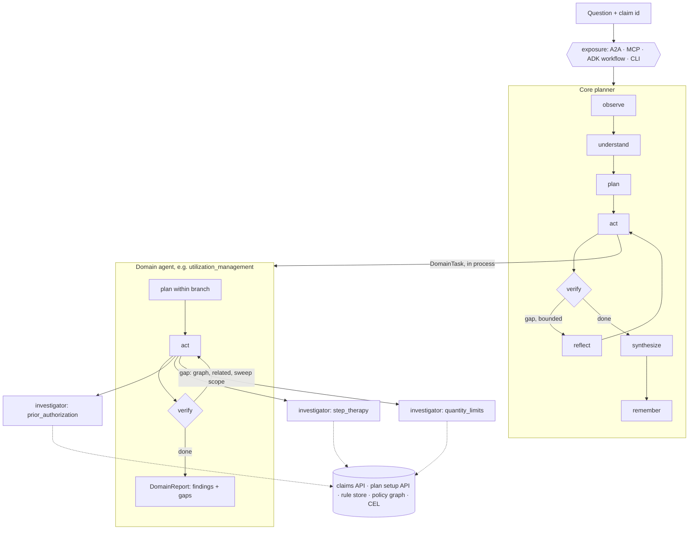

# Madhava agent system: core agent, domain agents, memory and the rules/policy graph

**Status:** reference implementation (v0.3) over synthetic sample data.
**Builds on:** [`claim-explainability-design.md`](claim-explainability-design.md) (rule cards, effective-dated rule sets, confidence labels, MCP tools) and [`madhava-architecture.html`](madhava-architecture.html) (architecture page, production stack).

The system answers any question about why a pharmacy claim behaved the way it did. A **core agent** understands the question, routes it through an **adjudication taxonomy** to **domain agents**, checks that every observed outcome is explained, loops when one is not, and writes one answer with citations. Each domain agent is itself a **planner** with the same loop, scoped to its branch of the taxonomy: it plans which of its **rule domains** to check, runs an **investigator** per rule domain, verifies its own coverage, runs its own bounded gap round, and either answers a user directly or reports findings and gaps to the core. Investigators search a **rules/policy graph** for candidate rules, read only the claim and plan setup fields those rules need, and evaluate them deterministically.

---

## 1. Where the code lives

| Part | Repository / path | Package | Contents |
|---|---|---|---|
| Kernel | this repo, `kernel/` (moves to its own repo later) | `rulegraph` | Planner, investigator, synthesis, language layer, memory types, rule store, policy graph, CEL evaluator, toolbox, knowledge sources and composition, domain discovery, evaluation, scaffolding. No agent SDK in core modules. Extras: `adk` (Google ADK workflow, A2A server, ADK model completion), `mcp` (MCP server). |
| Pharmacy base | this repo, `base/` (moves later) | `pharmacy_base` | Base pack: manifest and wording, ontology, reject codes, the seven top concepts with adjudication order, shared claim and plan fields, domain planner procedures, investigator playbook, intents. Claim adapter, toolbox over the claims and plan setup APIs, fixtures, `pharmacy-domains` CLI. |
| Domain agents | [madhava-ai-subagent](https://github.com/Satveerskhaira/madhava-ai-subagent) | `pharmacy_agents` | Seven fragments (eligibility, coverage, utilization management, clinical DUR, network, COB, cost share), each its own pack, entry point, goldens and tests. Any one can move to its own repo by moving its folder. |
| Core agent | this repo, `src/madhava/` | `madhava` | Core planner procedures (`procedures/planner.yaml`), `build()` composing the base with every installed domain package, cross-domain goldens, CLI, A2A and MCP exposure. |

Each domain package registers a `DomainPackage` under the `rulegraph.domains` entry point. At start-up the core composes the base pack with every installed fragment into one knowledge set, builds one toolbox and one episodic memory, and gives them to every domain agent, which runs **in process**: domains share context and memory without a network hop. Only the core is exposed over a network (A2A, MCP). Knowledge loads through a source interface (`DirectorySource` today); a MongoDB-backed source can replace the files later without changing the agents. The kernel knows nothing about pharmacy: all domain words come from the packs and the claim adapter.

## 2. The layers

| Layer | Question it answers | Where it lives |
|---|---|---|
| **AI** | What needs language understanding? | `rulegraph/agent/language.py`: `DeterministicLanguage` (regex intents and taxonomy labels) by default; `ModelLanguage` takes any `async complete(system, user)` function, with guardrails |
| **Agents** | Who owns which part of the answer? | `rulegraph/agent/planner.py` (core and domain agents are both `Planner`), `agent/investigator.py` (one per rule domain), `agent/factory.py` (`domain_agents`, `core_planner`), `agent/cards.py` |
| **Harness** | What can an agent see and do? | `rulegraph/tools/` (toolbox, record and reference APIs), `catalog.py`, `rules/` (store, graph, CEL, validation), the knowledge pack |
| **Loops** | When to try again, and when to stop? | Gap rounds in every planner (`verify` → `reflect`), investigator `widen_if_unexplained`, session follow-ups, golden replay (`evaluation.py`) |
| **Graphs** | How does work move? | The planner loop (also available as an ADK 2 workflow graph via `adapters/adk.py`), concurrent fan-out, `rules/graph.py` (policy graph) |



Two model calls at most per question (understand, narrate), and none by default. Everything that decides an outcome is deterministic: routing, rule retrieval, evaluation, overrides, precedence and the coverage check.

## 3. Three levels, one planner

| Level | Executors | Scope | Routing (`unit_for`) | Procedures |
|---|---|---|---|---|
| Core (`core_planner`) | the seven domain agents | the whole taxonomy | concept → agent | `src/madhava/procedures/planner.yaml` |
| Domain agent (`domain_agent`) | one investigator per rule domain in its branch | its top concept and descendants | concept → rule domain | `pack/procedures/domain_planner.yaml` |
| Investigator | none: fixed playbook | the concepts of one rule domain | n/a | `pack/procedures/investigator.yaml` |

A `Planner` is also an `Executor` (`name` and `async handle(DomainTask) -> DomainReport`). That is what makes the levels compose: the core hands a domain agent a task exactly as a domain agent hands an investigator one. Anything with that interface can stand in for a domain agent: a mock in a test, an SDK-wrapped agent, or a client for a remote service if a domain ever has to be deployed on its own.

Domain agents run two kinds of procedure:
- **Delegated** (`delegated_explain`, `delegated_what_if`): a task from the core with outcome tokens, concepts and rule hints. Must explain the task's tokens; tokens outside the agent's branch come back as gaps for the core to route.
- **Direct** (`explain_outcome`, `explain_cost`, `what_if_approved`, `compare_current`, `define_term`): a user question to one agent, answered from that domain's point of view (`pharmacy-agents ask network RX-1007 "Why?"`). Outcomes outside the branch are reported as out of scope, never guessed.

## 4. Knowledge model

All knowledge is plain YAML, reviewed through pull requests and validated in CI. It is split into a **base pack** (`base/src/pharmacy_base/pack/`) and one **fragment** per domain agent (`packs/<agent>/` in the domain agents repo). The base manifest names the record and reference roots (`claim`, `plan`), the nouns used in answers and tool names, and pharmacy wording (for example "as adjudicated", "The member paid ..."); a fragment's manifest says `kind: fragment` and `extends: pharmacy-claims`. Composition refuses conflicts (the same concept, notation, rule domain or field defined twice). Each domain repo validates its fragment on the base alone (`pharmacy-domains validate`); `madhava validate` checks everything installed together with the core procedures.

| In the base | In each domain fragment |
|---|---|
| Ontology, reject codes, taxonomy scheme and the seven top concepts with precedence | Concepts under its top concept (leaves with `rule_domain` and `notations`) |
| 13 fields read by several domains (drug, channel, days supply, tier, ...) | Fields only its rules read |
| Domain planner procedures, investigator playbook, intents, wording | Rule domains, releases, rule cards; investigator notes for its agent |

### 4.1 Ontology (base: `pack/ontology/pharmacy.ontology.yaml`)

Classes (Claim, ClaimResponse, Member, Drug, Pharmacy, Plan, PlanVersion, FormularyEntry, BenefitSetting, Accumulator, Outcome, Concept, Rule, RuleSet, Policy, Field, Finding, Evidence) and typed relations (`explains`, `in_domain`, `reads`, `overridden_by`, `derived_from`, `broader`, `related`, `classifies`, `describes`, ...). Each class records `aligns_with` for NCPDP and HL7 FHIR.

It is enforced: every catalog field must sit on an ontology class, and the policy graph refuses any edge whose relation, domain and range are not declared. Export: `rulegraph export ontology <pack>` (OWL in JSON-LD).

### 4.2 Taxonomy (base: top concepts; fragments: the concepts under them)

A SKOS concept scheme of adjudication outcomes. Each concept has `prefLabel`, `altLabels`, `definition`, `broader`, `related` and `notations` (outcome tokens such as `reject:75` or `price:copay`).

- **Top concepts carry `agent` and `precedence`**: they define the domain agents and the adjudication order used to pick the primary reason.
- **Leaf concepts carry `rule_domain`**: the unit rules are authored, owned and released in, and the unit each investigator covers.
- **`related` links** drive gap rounds (quantity limits ~ specialty channel).

| Domain agent | Precedence | Rule domains (investigators) | Example outcomes |
|---|---|---|---|
| eligibility | 10 | eligibility | reject 65, 67, 68, 69 |
| coverage | 20 | formulary | reject 70, MR, tier placement |
| utilization_management | 30 | prior_authorization, step_therapy, quantity_limits | reject 75, 608, 76, 7X |
| clinical_dur | 40 | dur, refill_too_soon | reject 79, 88 |
| network | 50 | network | specialty channel limits |
| cob | 60 | cob | reject 41 |
| cost_share | 70 | benefit_copay, accumulators | copay, coinsurance, deductible |

Adding a domain agent is a top concept in the base and a new domain package; the core picks it up when the package is installed, without code changes. Cross-domain `related` links in a fragment are kept aside until the other domain is installed. Export: `rulegraph export taxonomy <pack>` (SKOS in JSON-LD).

### 4.3 Field catalog (base: shared fields; fragments: their own)

The closed vocabulary rules may read. Claim fields map to NCPDP Telecommunication D.0 fields where one exists (`401-D1` date of service, `511-FB` reject code, `505-F5` patient pay, ...). Plan fields carry a JSON Pointer into the plan setup payload, with `{placeholders}` filled from other catalog fields:

```yaml
- path: plan.costShare.copay
  source: reference
  pointer: "/costShare/tiers/{tier}/{channel}/copay"
  params: {tier: plan.formulary.drug.tier, channel: claim.pharmacy.channel}
```

The slice tool resolves `tier` from the plan first, then `channel` from the claim, and reads one value out of a payload of more than 12,000 fields.

### 4.4 Rule cards and rule sets (each fragment's `domains/<rule_domain>/`)

Conditions are in **CEL**:

```yaml
id: R-PA-001
version: 2
domain: prior_authorization
concept: um.prior_authorization
outcome: {type: reject, code: "75"}
record_inputs: [claim.drug.name, claim.priorAuth.onFile]
reference_inputs: [plan.formulary.drug.paRequired, plan.formulary.drug.tier, plan.um.priorAuth.requiredTiers]
condition: >
  ((has(plan.formulary.drug.paRequired) && plan.formulary.drug.paRequired)
   || (has(plan.formulary.drug.tier) && plan.formulary.drug.tier in plan.um.priorAuth.requiredTiers))
  && !claim.priorAuth.onFile
overridden_by: [R-PA-OVR-002]
template: "{{claim.drug.name}} needs prior authorization on this plan ..."
```

Outcome types are `reject`, `pricing` (an `amount` expression and the `actual` claim field it should match), `info` (supporting facts such as tier placement) and `override`.

`domain.yaml` holds each rule domain's effective-dated releases (`RS-PA-2026.01.1` until 2026-10-01, then `RS-PA-2026.10.1`). Rules in force are resolved in one of three rules modes: `as_decided` (shown as "as adjudicated": the adjudication date by default), `current`, or `as_of` a given date. Plan setup is always resolved by date of service.

### 4.5 Procedures

Procedural memory (section 5.3): core procedures in this repo, domain planner procedures, the investigator playbook and intent patterns in the pack.

### 4.6 Glossary (base: shared terms; fragments: their own)

A SKOS concept scheme separate from the taxonomy: business terms and abbreviations ("PA", "OCC", "days supply"), each with a definition and, where it applies, the taxonomy concepts it is about. Reject code meanings join the glossary automatically from the code table. Definition questions ("What is PA?") are answered from it, and the `lookup_term` tool exposes it.

### 4.7 Policy text (fragments, plus shared sections in the base)

The source sections rule cards cite (`source_refs`), with their text, owner, version and effective date. Once a pack keeps policy text, `validate` requires every cited section to be there. Answers carry the passages behind every rule they cite (`Explanation.sources`), so a reader can see the policy wording, and the `get_policy_section` tool returns a section with the rules derived from it. The sample sections are marked `sample: true`.

### 4.8 Standards, storage and viewing

| Need | How |
|---|---|
| Author with checking | JSON Schema for every file type (`rulegraph schemas`), run by `validate` and usable in editors |
| Publish in standard form | `export graph` (JSON-LD or Turtle): OWL ontology, SKOS taxonomy and glossary, fields, outcomes, rule versions with CEL and PROV-O sources, rule sets, policy text |
| Check the graph with any tool | SHACL shapes (`export shapes`, `madhava shacl`) |
| Store and load | MongoDB (`madhava publish`, `rulegraph.adapters.mongodb`), with releases flipped in one step; files and MongoDB give the same knowledge |
| See it | `madhava view`: the offline knowledge browser. See [`viewing-knowledge.md`](viewing-knowledge.md) |

## 5. Memory

| Memory | What it holds | Used for | Local | Production |
|---|---|---|---|---|
| **Working** | The blackboard for one question at one level: record summary, tokens, plan, tasks, reports, rounds, gaps, out-of-scope tokens, trace (`memory/working.py`) | Passing state between steps; replay | In memory, or ADK session state when run as a workflow | ADK session service (Firestore, Redis or database) |
| **Episodic** | Past explanations with reports, and coverage gaps (`memory/episodic.py`) | Audit; follow-ups in a session reuse earlier reports; SME backlog | In memory, or JSONL with `MADHAVA_EPISODIC_DIR` | BigQuery + `explanation_log` |
| **Semantic** | Searchable text for rules, fields, concepts, reject codes (`memory/semantic.py`) | Graph search seeds, definitions, widening | BM25 + taxonomy synonyms; optional embedder | MongoDB Atlas Vector Search |
| **Procedural** | Core procedures, domain planner procedures, investigator playbook, intents (`memory/procedural.py`) | Which units to ask, what must be explained, loop limits, investigation steps | YAML | Same YAML, versioned in Git |
| **Taxonomic** | The SKOS concept scheme (`memory/taxonomic.py`) | Classifying outcomes, recognising concepts, agent and rule-domain ownership, precedence, related expansion | YAML | Same, exported as JSON-LD |

Core and domain agents share one knowledge pack, one toolbox (so the claim is fetched once per question) and one episodic memory.

### 5.1 Semantic memory

BM25 over rule intents, templates and source documents, field descriptions, concept definitions and reject code meanings, with queries expanded by taxonomy synonyms ("prior auth" also searches "prior authorization", "PA"). Pass an `embed` function for hybrid lexical and vector scoring.

### 5.2 Episodic memory

Every answer is recorded with its reports, confidence, rule sets and plan version. A follow-up in the same session ("what would it cost if approved?") reuses the reports already gathered and asks only the new agent. Every outcome still unexplained at the core is logged as an open gap: the SME backlog (`madhava gaps`).

### 5.3 Procedural memory

Core procedures (`src/madhava/procedures/planner.yaml`):

| Procedure | Routes from | Speculative agents | Must explain | Loop |
|---|---|---|---|---|
| explain_outcome | outcome tokens, question concepts | eligibility, coverage | outcome tokens | 2 rounds: policy graph, related concepts |
| explain_cost | amount tokens, question concepts | coverage, cost_share | amount tokens | 2 rounds |
| what_if_approved | | cost_share (what-if mode) | none | 1 |
| compare_current | outcome tokens, question concepts | all reject-capable agents | outcome tokens | runs under as-decided and current rules |
| define_term | | | none | semantic memory only |

Domain planner procedures (`pack/procedures/domain_planner.yaml`): the delegated and direct procedures of section 3, all with `sweep_if_unrouted` (check the whole branch when nothing routes) and gap rounds that expand by policy graph, related concepts, then a sweep of the rest of the branch.

Investigator playbook (`pack/procedures/investigator.yaml`): `recall_rules → resolve_inputs → evaluate → apply_overrides → widen_if_unexplained (max 1) → phrase`, with per-mode settings (what-if mode evaluates pricing rules and ignores actual amounts) and per-agent notes.

## 6. The rules/policy graph and how relevant rules are picked

**Nodes:** concepts, glossary terms, outcomes, rules, fields, policy sections, rule sets (159 nodes and 255 edges for the sample knowledge, 18 rule versions in 11 rule domains, 49 catalog fields, 38 glossary terms, 19 policy sections, 12 rule sets).
**Edges used by rule search:** `broader`, `related`, `classifies` (taxonomy), `explains`, `in_domain`, `reads`, `overridden_by`, `derived_from` (rule cards), `describes` (catalog). The graph is the union over rule versions; the version in force is applied at search time.
**Structural edges** (impact analysis, export, browsing; never followed by rule search, so adding them cannot change which rules an agent finds): `depends_on` (field to the fields its JSON Pointer needs), `member_of` (rule to rule set), `supersedes` (rule set to the one it replaces), `about` (glossary term to concept).

**Search** (`PolicyGraph.search`):

1. **Seeds.** Outcome tokens on the claim (weight 1.0), concepts in the task or question (0.8), rule hints from the planner above (1.0), rules found by semantic search (up to 0.5).
2. **Walk.** Best-first from each seed, up to four hops. Each hop multiplies by an edge weight (`explains` 1.0, concept to its rules 0.9, to narrower concepts 0.85, `related` 0.6, ...). Fields read by many rules are damped.
3. **Filter.** Only rules in the rule sets in force on the resolution date, and only rules inside the asking planner's or investigator's scope.
4. **Rank.** Sum over seeds of the best path score; each hit keeps the path that reached it.
5. **Evaluate, then pick.** Candidates are evaluated with CEL. A rule explains an outcome only if it fired, its outcome token was observed, and, for pricing, its amount matches the claim. The **primary reason** is the explaining rule first in adjudication order (taxonomy precedence, then rule order). Overrides are evaluated before a rule is reported, and duplicate findings across agents are merged.

**Routing a token** in any planner: taxonomy notation first; if the concept is outside the planner's scope or unclassified, the policy graph within scope; rule hints go straight to the unit that owns the rule.

## 7. Loops: nested, each with a verifier and a cap

Real traces for RX-1007, rejected with 76 (plan limitations exceeded), which the obvious domain cannot explain.

The utilization management agent, asked directly, routes 76 to quantity limits, finds nothing, sweeps the rest of its branch, and reports a gap instead of guessing:

```
plan: procedures=['explain_outcome'] must_explain=['reject:76'] tasks=['quantity_limits:explain:as_decided']
act r1: quantity_limits/explain/as_decided fired=[]
reflect: reject:76 -> prior_authorization via sweep of remaining scope
reflect: reject:76 -> step_therapy via sweep of remaining scope
verify r1: unexplained ['reject:76'], gap round with ['prior_authorization', 'step_therapy']
act r2: prior_authorization/explain/as_decided fired=[]
act r2: step_therapy/explain/as_decided fired=[]
verify r2: unexplained ['reject:76'], no rounds left
```

The core receives that gap, searches the policy graph across all domains, and runs one gap round with the network agent:

```
observe: RX-1007 rejected tokens=['reject:76'] reference=PLN-COMM-4T@2026.07
plan: must_explain=['reject:76'] tasks=['utilization_management:explain:as_decided', 'eligibility:explain:as_decided', 'coverage:explain:as_decided']
act r1: utilization_management/explain/as_decided fired=[] gaps=['reject:76']
act r1: coverage/explain/as_decided fired=['R-FRM-INFO-001']
reflect: reject:76 -> network via policy graph outcome:reject:76 <-explains- rule:R-NET-001
reflect: reject:76 -> network via related concept um.quantity_limits ~ network.specialty_channel
verify r1: unexplained ['reject:76'], gap round with ['network']
act r2: network/explain/as_decided fired=['R-NET-001']
verify r2: all outcomes explained
```

| Loop | Runs | Verifier | Stops when |
|---|---|---|---|
| Core gap round | Core, per question | Coverage of outcome or amount tokens | All explained, procedure round limit reached, or nothing new to ask |
| Domain gap round | Domain agent, per task or question | Coverage of the task's tokens within its branch | All explained, round limit, or branch swept; the rest is reported as gaps |
| Widen if unexplained | Investigator, per task | CEL evaluator | A rule fires, or one widened search is done |
| Session follow-up | Core, per session | Coverage check per answer | The user stops |
| Improvement | Offline, on every change | Golden match rate (core 13/13, domain 15/15), gap log | Each change must keep the match rate |

A model never decides to loop, and never grades its own answer. Each task also runs under a deadline (`Settings.agent_deadline_s`, default 4 s); a late agent becomes an error report and the answer goes out with what is confirmed.

## 8. Getting data from the claims and plan setup APIs

- `get_record_outcome` calls the claims API once per claim. The claim adapter (`pharmacy_agents/record.py`) derives fields such as days since last fill and days since enrollment, builds reject and price tokens, and names the plan and dates; the plan version is pinned by date of service.
- `get_reference_slice` reads only the requested `plan.*` paths through catalog pointers, cached by plan, version and pointer. The sample payload has more than 12,000 fields; investigators typically read 3 to 10.
- Agents receive a **context reference** (claim id, plan id, date of service, rules mode and date), never a copy of the claim.
- Real services plug in through `PHARMACY_CLAIMS_URL`, `PHARMACY_BENEFITS_URL` and `PHARMACY_API_TOKEN` (`HttpRecordApi` and `HttpReferenceApi` with path templates in `pharmacy_agents/system.py`).

## 9. Standards used

| Area | Standard | How it is used |
|---|---|---|
| Exposing the core agent | **A2A** protocol 1.0 (a2a-sdk, ADK `to_a2a`) | `madhava serve`: the core as an A2A server with an agent card; one skill per domain agent, tagged with notations and rule domains. Core to domain agents is in process, not A2A. |
| Agent to tools | **MCP** (Model Context Protocol) | `madhava mcp`: the toolbox and the core as MCP tools; the contract the Java tool servers implement |
| Orchestration | Plain planner loop; **Google ADK 2** workflow graph as an option | `madhava ask --workflow` runs the core as an ADK graph with one bounded back edge; any planner can be built this way |
| Rule logic | **CEL** | Sandboxed, typed conditions and amounts, compiled once per rule version |
| Taxonomy and glossary | **W3C SKOS** in JSON-LD | Concept schemes, labels, abbreviations, broader/related, notations; glossary terms `closeMatch` taxonomy concepts |
| Ontology | **OWL / RDFS** in JSON-LD | Classes and typed relations, enforced on the graph |
| Knowledge graph | **RDF** (JSON-LD, Turtle) | `madhava export graph`: every node and edge in the ontology's vocabulary |
| Graph constraints | **W3C SHACL** | Shapes for rules, fields, concepts, terms, rule sets and policies (`madhava shacl`) |
| Provenance | **W3C PROV-O** | `prov:wasDerivedFrom` rule version → policy section; `prov:wasRevisionOf` between versions |
| Knowledge files | **JSON Schema** (draft 2020-12) | One schema per file type, checked by `validate` |
| Pharmacy claims | **NCPDP Telecommunication D.0** (plan for F6) | Field ids in the catalog; reject codes |
| Formulary and benefit | **NCPDP Formulary and Benefit**, Da Vinci US Drug Formulary | Alignment for formulary entries |
| Healthcare interop | **HL7 FHIR R4**: Claim, ClaimResponse, ExplanationOfBenefit, Coverage, Medication | Ontology alignment for mapping inputs and exposing answers |
| Messages | **JSON Schema** via pydantic models | Every task, report, finding and explanation |
| Data access | **JSON Pointer** (RFC 6901) | Reading plan setup fields |
| Observability | **OpenTelemetry** (ADK tracing) | One trace across core, domain agents and MCP |
| Security | OAuth2, mTLS, HIPAA minimum necessary | Context references instead of PHI copies; PHI-minimised MCP responses |

Other agent SDKs (LangGraph, OpenAI Agents SDK, Claude Agent SDK, CrewAI) attach at the same edges: wrap `core.ask` as a tool or node, and pass a `complete` function for model understanding. The skill `rule-graph-agent-system` (`references/sdk-adapters.md`) has the patterns.

## 10. Running it

```bash
pip install -r requirements-dev.txt                # kernel and base (this repo), domain packages (pinned), core
madhava validate                                   # schemas, cross-file checks, core procedures
madhava view                                       # offline knowledge browser (docs/viewing-knowledge.md)
madhava knowledge-service --mongo mongodb://127.0.0.1:27017   # knowledge API + live browser (docs/knowledge-application.md)
madhava export graph --format ttl --out k.ttl      # also taxonomy, ontology, glossary, shapes, graphml
madhava shacl                                      # SHACL check of the knowledge graph
madhava publish --uri mongodb://localhost:27017    # packs to MongoDB
madhava --today 2026-10-14 eval                    # core goldens: 13/13
madhava ask RX-1001 "Why was this rejected, and what would it cost if approved?"
madhava ask RX-1007 "Why did this reject?" --trace # domain gap -> core gap round
madhava ask RX-1012 "Would this claim still pay today?"
madhava ask RX-1001 "Why was this rejected?" --workflow     # core as an ADK workflow graph
madhava ask "What does reject code 76 mean?"       # knowledge question, no claim
madhava serve --port 8100                          # core over A2A
madhava mcp                                        # toolbox + core over MCP (stdio)
pytest tests                                       # core: 24 tests
pytest kernel/tests                                # kernel: scaffolded projects start green

pharmacy-domains agents                                              # installed domain agents
pharmacy-domains ask network RX-1007 "Why did this reject?" --trace  # one domain agent directly
pharmacy-domains --today 2026-10-14 eval goldens/domain_goldens.yaml # a domain repo's goldens
```

Pass `--model gemini-2.5-flash` (or any ADK model name) to let a model help with understanding and narration; the guardrails still apply.

## 11. Scaling to production

| Concern | Reference implementation | Production |
|---|---|---|
| Domain agents | In process, discovered packages (one per domain) | Still in process inside the core's pods (stateless, scaled with the core). If one domain needs its own scaling or release cycle, serve it and give the core a client `Executor` for it; nothing else changes |
| Tool servers | Python toolbox and MCP server | Java / Spring Boot MCP servers implementing the same tool contract |
| Rules and rule sets | YAML in the base and domain fragments | Git-first authoring per domain repo, published to MongoDB; a MongoDB `KnowledgeSource` returns the same documents, so composition and agents do not change; refresh through change streams |
| Policy graph | Built in memory at start | Still in memory per pod (rules number in the thousands), rebuilt on change streams |
| Semantic memory | BM25 | Atlas Vector Search with the approved embedding model |
| Caches | Per-process | Redis for plan slices and claim snapshots, keyed by version |
| Episodic memory | Memory or JSONL | BigQuery and `explanation_log` |
| Models | Optional | Enterprise LLM gateway; small model for understanding, stronger model for narration |

Every planner runs a fixed loop, investigators run fixed playbooks, and loops are capped at every level, so cost and latency per question are known in advance.

## 12. Extending

- **Add a rule** (in the domain agents repo, under the owning domain's fragment): a card under `packs/<agent>/domains/<rule_domain>/rules/`, listed in a new release in `domain.yaml`; run `pharmacy-domains validate` and `pharmacy-domains eval goldens/domain_goldens.yaml`, then bump that package's pin here and run `madhava eval`.
- **Change a rule:** a new version file and a new release with `effective_from`; never edit a published version.
- **Add a domain agent:** a top concept with `agent` and `precedence` in the base; a new fragment in the domain agents repo (leaves with `rule_domain`, fields, rule domains, rules), entry point and domain goldens; then bump the pin here and add core goldens.
- **Move a domain into its own repo:** move `packs/<agent>/`, its goldens and its entry point to a new package that depends on `pharmacy-base`; nothing else changes.
- **Add a question type:** a procedure in the core `planner.yaml` and in the pack's `domain_planner.yaml`, and an intent pattern in `intents.yaml`.
- **Connect real APIs:** set the URLs in section 8; extend the catalog with real field paths and pointers.
- **Build a new system on the kernel:** `rulegraph new subagents ...` then `rulegraph new core ...` (see `kernel/README.md` and the skill).

## 13. What is sample data

Claims, plan setup, drug keys (`SAMPLE-*`), policy document names and rule content are synthetic and exist to exercise every path: rejects across all seven agents, copay, coinsurance and deductible pricing, an override, a what-if estimate, domain and core gap rounds, an unexplained code, a rule change after the claim, and date-of-service plan resolution. Reject code descriptions and NCPDP field ids should be checked against your payer sheet and code list before use.
