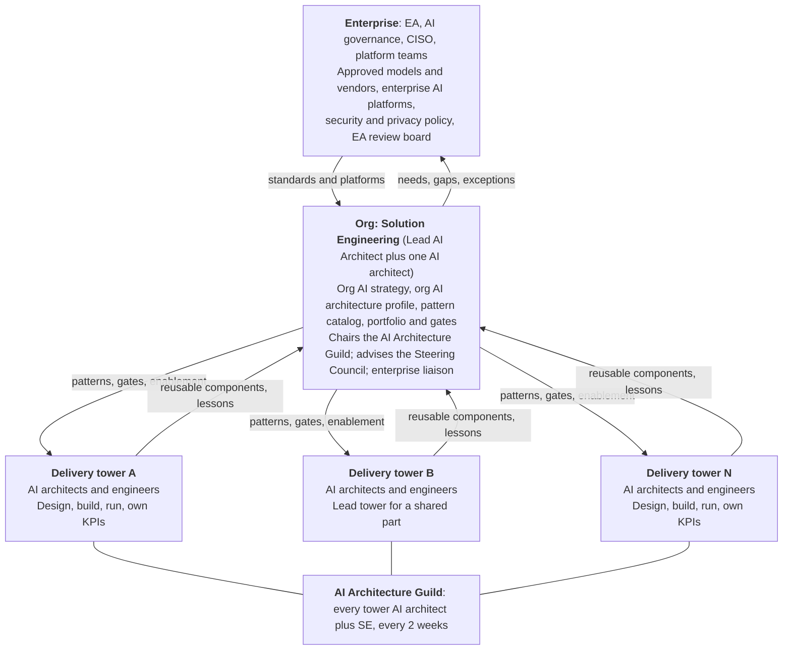

# 2027 AI Strategy: From +AI to AI+

As of 23 November 2026 · Satveer Singh

## Executive summary

In 2027 the BU should stop adding AI to existing work (+AI) and redesign three to five high-value value streams around governed agents (AI+). Enterprise guardrails and platforms come first. Solution Engineering sets the org's direction and patterns. The delivery towers build and run the solutions.

The market rewards redesign, not adoption. [McKinsey's 2026 State of AI](https://www.mckinsey.com/capabilities/quantumblack/our-insights/the-state-of-ai) found 44% of organizations now scale AI, but only 37% report any EBIT impact, flat from 2025. High performers are about three times as likely to have redesigned workflows. [Gartner](https://www.hpcwire.com/bigdatawire/this-just-in/gartner-predicts-over-40-of-agentic-ai-projects-will-be-canceled-by-end-of-2027/) expects over 40% of agentic AI projects to be canceled by the end of 2027 for cost, unclear value or weak risk controls.

**Our structure shapes the strategy.** Solution Engineering (SE) has one or two AI architects. Enterprise Architecture (EA) sets enterprise-wide guidelines. Each delivery tower has its own AI architects and engineers. So SE cannot be a platform-building hub. It is the org's AI design authority, portfolio steward and bridge between the enterprise and the towers. It multiplies its reach through a guild of tower AI architects.

**Five recommendations for 2027**

1. **Declare AI+ for a few lighthouse value streams.** Candidates are the SDLC, incident/SRE, testing, legacy modernization and one business-domain decision flow. Keep copilots (+AI) as the baseline everywhere else.
2. **Adopt a three-layer operating model.** Enterprise sets the guardrails and platforms. The org (SE) adapts them into an org AI architecture profile and runs the portfolio. Towers build, run and own outcomes.
3. **Give one Lead AI Architect in SE an explicit mandate** to lead the org AI strategy. That mandate covers the org's AI standards, the Tier 2 and Tier 3 go/no-go gates, and the portfolio recommendation.
4. **Scale through people, not headcount.** Form an AI Architecture Guild of tower AI architects. Run tiered reviews and an inner-source catalog of reusable components, each owned by a lead tower.
5. **Measure outcomes and unit cost, not licenses.** Track lead time, change-failure rate, MTTR, cost per outcome and AI risk incidents. Stop any use case that cannot show KPI movement at its second gate.

## Market view for 2027

AI spending is surging, but value is concentrated in the few organizations that redesign work, own their platforms and enforce governance in code.

| Signal | Latest datapoint | What it means for us |
| --- | --- | --- |
| Worldwide AI spend | $2.67T in 2026, forecast $3.64T in 2027 ([Gartner, Sep 2026](https://qz.com/ai-agents-workplace-gartner)) | AI will be embedded in everything we buy. Budget for consumption, not only licenses |
| AI agent and assistant spend | $29B in 2026 to $65B in 2027, forecast (Gartner) | Fastest-growing category; high risk of vendor sprawl |
| Share of tech budget | 1 in 5 dollars to AI in 2027, forecast ([Forrester](https://www.nasdaq.com/press-release/forresters-2027-technology-and-security-predictions-ai-will-account-20-all-business)) | Fund AI by reallocating services and seat-based software spend |
| Value capture | 37% report any EBIT impact; 6% are high performers ([McKinsey 2026](https://www.mckinsey.com/capabilities/quantumblack/our-insights/the-state-of-ai)) | Adoption no longer differentiates; redesign does |
| Governance gap | 23% use agentic AI today; 21% have mature agent governance ([Deloitte 2026](https://www.deloitte.com/cz-sk/en/services/consulting/research/the-state-of-ai-in-the-enterprise.html)) | Governance is the bottleneck to scale |
| Operating cost | About 20% say AI running costs already constrain use (McKinsey) | AI FinOps is mandatory in 2027 |

**Agentic AI is real, with heavy attrition.** Beyond Gartner's 40% cancellation forecast, Gartner also warns of "agent washing" by vendors. It predicts 70% of enterprises will abandon agents built by vendor forward-deployed engineers by 2028. Forrester expects flagship AI deployments to be reversed where accountability sits apart from policy enforcement. Both point to owning our agents and enforcing policy in the platform.

**Coding agents amplify what is already there.** [Google's 2025 DORA report](https://www.splunk.com/en_us/blog/learn/state-of-devops.html) found 90% of technologists use AI. It also found AI correlates with higher throughput and higher delivery instability. METR's randomized trial found experienced developers 19% slower while believing they were faster. The lesson: upgrade testing and measure from a baseline, not from self-reports.

**Standards have consolidated.** MCP (agent-to-tool) moved to the Linux Foundation's Agentic AI Foundation in December 2025. A2A (agent-to-agent) reached v1.0 in March 2026 and joined the same foundation in August 2026 ([Forbes](https://www.forbes.com/sites/janakirammsv/2026/08/19/agent2agent-joins-the-agentic-ai-foundation-alongside-mcp/)). Gartner forecasts that by 2028, 25% of enterprise breaches will trace to AI agent abuse. That makes agent identity and least privilege first-class concerns.

**Capability is getting cheaper while bills grow.** [Epoch AI](https://epoch.ai/data-insights/llm-inference-price-trends) estimates the cost of a fixed capability level falls about 13x a year. Reasoning models and long agent loops still raise cost per task. Model routing and token budgets are the response.

**Regulation is uneven but real.**

- The EU AI Act high-risk obligations now apply from 2 December 2027.
- Colorado's revised AI Act targets 1 January 2027.
- Several states bar AI-only medical-necessity denials.
- CMS-0057-F prior-authorization API requirements begin 1 January 2027.
- The Section 1557 duty to mitigate algorithmic discrimination is already in force.

The NIST AI RMF and its GenAI profile remain the US control baseline. Verify these with counsel before relying on them.

**Work is being redesigned, not eliminated.** Only 14% of organizations report AI-driven headcount declines (McKinsey). Gartner describes the developer role shifting from implementation to orchestration.

## The +AI to AI+ shift

+AI keeps today's process and adds AI on top. AI+ redesigns the process assuming agents do the repeatable work and humans set intent, supervise and stay accountable.

**+AI ("plus AI")** puts the existing process, systems and org chart first. Examples are a copilot in the IDE, a chatbot on the wiki, or a summarize button in the ticketing tool. The unit of work is unchanged and humans still orchestrate every step. Value is capped at individual task speed-up. That explains why productivity anecdotes are everywhere while EBIT impact stays flat. [Deloitte](https://www.deloitte.com/cz-sk/en/services/consulting/research/the-state-of-ai-in-the-enterprise.html) finds 37% of companies use AI at a surface level with little process change.

**AI+ ("AI first, plus the domain")** redesigns the work assuming agents can plan, call tools and run multi-step tasks. Humans move from doing each step to setting intent, handling exceptions and owning outcomes. Architecture, data, controls, metrics and roles are rebuilt to match. [BCG's](https://www.bcg.com/publications/2025/are-you-generating-value-from-ai-the-widening-gap) "future-built" companies (about 5%) work this way, on central platforms and reusable agents.

**A simple test:** remove the AI. A +AI process just runs slower. An AI+ process would have to be redesigned.

**AI+ is not "AI everywhere."** It is redesign where the value justifies it and governance can keep up.

| Dimension | +AI (AI-enabled, bolt-on) | AI+ (AI-native, redesigned) |
| --- | --- | --- |
| Process | Same workflow; AI assists single steps | Re-engineered end to end; agents execute, humans supervise exceptions |
| Architecture | Point integrations; vendor copilots in silos | Enterprise agent platform plus org patterns: gateway, model routing, MCP registry, agent identity, evals, tracing |
| SDLC | Code completion; same ceremonies and gates | Spec-driven; agents draft code, tests, docs and migrations asynchronously; CI gates include evals and policy checks |
| Data | Data as is; RAG bolted onto wikis | Governed context products (APIs, MCP servers, knowledge graphs) with owners and SLAs |
| Talent | Prompt training for all | Engineers as agent orchestrators and reviewers; new roles such as eval engineer and AI product owner |
| Metrics | Licenses, active users, self-reported time saved | Lead time, change-failure rate, MTTR, cost per outcome, decision accuracy |
| Governance | Policy documents; manual review per tool | Policy-as-code, agent registry, risk-tiered autonomy, continuous evaluation, audit by default |
| Funding | Tool licenses per tower | Stage-gated value-stream funding; token budgets; savings reinvested |
| Decision rights | Each tower picks its own tools | Enterprise sets guardrails, org sets patterns, towers own outcomes |

## Vision, principles and pillars

**Vision for 2027:** every delivery tower ships and runs software through a governed, agent-augmented value stream. Engineers set intent and assure outcomes, and agents do the repeatable work. Every AI decision is explainable, auditable and cost-accounted, within enterprise guardrails.

**Guiding principles**

1. **Outcome before tool.** Nothing is funded without a baselined KPI and a named business owner.
2. **Redesign, don't decorate.** Lighthouse value streams are rebuilt end to end. Copilots elsewhere are hygiene, not strategy.
3. **Enterprise first, org profile second.** We build on EA standards and enterprise platforms. Org patterns extend them and never fork them.
4. **Build once, reuse everywhere.** A component built by one tower is published for all.
5. **Humans accountable, autonomy earned.** Autonomy rises by risk tier only with evaluation evidence. No AI-only adverse decisions on members, patients or claims.
6. **Open standards, model-agnostic.** Use MCP, A2A and OpenTelemetry-style tracing, with routing across frontier, small and open models.
7. **Secure and private by design.** Minimize PHI and PII, give agents least-privilege identities, defend against prompt injection, and keep full lineage.
8. **Unit economics are visible.** Every production agent has a budget and a cost-per-outcome metric.

**Strategic pillars**

| # | Pillar | 2027 objective | Key moves | Who leads |
| --- | --- | --- | --- | --- |
| P1 | AI-native SDLC | Move from IDE copilots to governed asynchronous coding agents in every tower | Org coding-agent harness profile; spec templates; AI-aware CI gates; test automation upgraded first | SE patterns; towers adopt |
| P2 | Agent platform and reuse | Every agent runs on enterprise platforms plus the org profile; 10 or more reusable components in the catalog | Org profile over enterprise gateway and registry; inner-source catalog; lead-tower ownership | Enterprise platform; SE curates |
| P3 | Data and context readiness | Context products for the top 10 domains, such as claims, formulary, eligibility and pricing | MCP servers over governed APIs and warehouse data; data contracts; permission-aware retrieval | Towers build; SE sets conventions |
| P4 | AI in domain products | Two or three explainable decision-support flows in production | Human-in-the-loop for adverse decisions; reason codes; audit trails | Towers; SE design authority |
| P5 | Governance, risk and security | Risk-tiered, policy-as-code governance mapped to NIST AI RMF | AI inventory; risk tiers; model and agent cards; red-teaming; Section 1557 and state-law checks | Enterprise policy; SE org gates |
| P6 | AI FinOps | Cost per outcome known for every production agent | Token budgets per tower; showback; model routing; caching | SE defines; towers own budgets |
| P7 | Talent and change | Every engineer trained on the org profile; the guild active | Role-based learning paths; AI champions; redesigned apprenticeship for juniors | SE plus tower leads |

## Operating model: enterprise, org and towers

The model has three layers. Enterprise Architecture sets the guardrails and platforms. Solution Engineering turns them into the org's AI direction and patterns. The towers' own AI architects and engineers build and run.

Standards flow down and needs flow up through SE. The guild connects the tower AI architects directly.

**Why not a central AI hub.** A hub that builds everything needs a platform team; SE has one or two AI architects. A fully decentralized model produces agent sprawl and governance gaps. [Forrester](https://www.forrester.com/press-newsroom/forrester-2027-asia-pacific-predictions/) predicts some enterprises will find 10 shadow agents for every sanctioned one. The answer is a small design authority that works through the tower architects.

**What each layer owns**

| Layer | Who | Owns | Does not own |
| --- | --- | --- | --- |
| Enterprise | EA, enterprise AI governance, CISO, Privacy, Compliance, enterprise platform teams | Approved models and vendors, enterprise AI platforms, security and privacy policy, enterprise standards, the enterprise review board | Org portfolio, org patterns, tower delivery |
| Org | Solution Engineering (Lead AI Architect plus one AI architect), AI Steering Council | Org AI strategy and roadmap, the org AI architecture profile, the cross-tower pattern catalog, portfolio and gates, the guild, the enterprise liaison role | Building and running platforms; designing every solution |
| Towers | Tower AI architects, AI engineers, AI product owners | Use-case discovery, solution design, build and run, domain context products, adoption and KPIs, lead-tower components | Enterprise or org standards (they contribute, but don't set them) |

**SE as the bridge, in both directions**

- **Down:** translate enterprise guidelines into an org AI architecture profile towers can use. It holds reference architectures, MCP conventions, eval templates, a production-readiness checklist and approved model routing within the enterprise list.
- **Up:** bring tower needs, gaps and exception requests to EA forums with evidence. Co-author enterprise standards rather than only receiving them.
- **Across:** stop towers solving the same problem five ways. Spot duplication, assign a lead tower and harvest components into the catalog.
- **Pilot ground:** offer the org as early adopter for new enterprise capabilities, such as agent identity or a new gateway feature.

**Forums**

| Forum | Cadence | Members | Purpose |
| --- | --- | --- | --- |
| AI Steering Council | Monthly | BU leader (chair), tower heads, Lead AI Architect, Risk/Privacy/Compliance delegates | Portfolio priority, funding gates, Tier 3 risk acceptance |
| AI Architecture Guild | Every 2 weeks | Lead AI Architect (chair), SE AI architect, every tower AI architect | Pattern catalog, peer reviews, shared evals, reuse decisions |
| AI design review | Weekly, as needed | Lead AI Architect plus two guild reviewers | Tier 2 sampling and Tier 3 org-level review |
| EA review board | Per EA cadence | EA plus the Lead AI Architect as org sponsor | Tier 3 and exceptions to enterprise standards |

**Tiered review keeps SE from becoming a bottleneck**

| Risk tier | Examples | Review path | Target turnaround |
| --- | --- | --- | --- |
| Tier 1: internal, no PHI, reversible | Documentation agent, code agent in a sandbox | Tower AI architect self-certifies against the org checklist; SE spot-checks 1 in 5 | 2 business days |
| Tier 2: production systems or PHI-adjacent, reversible | SRE remediation, test generation on real repos | Guild peer review (two tower architects); SE samples | 5 business days |
| Tier 3: member- or patient-affecting decisions | Claims explainability, prior-auth support | SE design review, then the EA review board, then Steering Council risk acceptance | 15 business days |

**Intake flow**

1. The tower AI product owner submits a one-page canvas: problem, KPI baseline, data and risk tier.
2. The tower AI architect maps it to an existing org pattern or flags it as new.
3. New patterns and Tier 3 items go to the SE design review.
4. The Steering Council scores and funds the use case.
5. The tower builds it in a 6–8 week sprint.
6. At Gate 2 the use case scales, pivots or stops, based on measured KPIs.
7. Reusable assets are harvested into the catalog.

**RACI** (R = Responsible, A = Accountable, C = Consulted, I = Informed)

| Activity | Enterprise (EA, governance) | Lead AI Architect (SE) | Guild | Tower AI architects | Tower leadership and AI PO |
| --- | --- | --- | --- | --- | --- |
| Enterprise AI standards and approved models | A/R | C (org voice) | I | I | I |
| Org AI strategy and roadmap | C | A/R | C | C | C |
| Org AI architecture profile and pattern catalog | C (conformance) | A | R | R | I |
| Use-case intake and value case | I | C | I | R | A |
| Solution design | I | C (Tier 3: A) | C | A/R | C |
| Tier 1 and 2 production readiness | I | C | R (Tier 2) | A/R | C |
| Tier 3 production readiness | A (enterprise board) | R | C | R | C |
| Enterprise platform build and operations | A/R | C | I | I | I |
| Reusable components (lead tower) | I | A (catalog) | C | R | C |
| Domain context products | C | C | C | R | A |
| AI FinOps budgets | C | R (framework) | I | R | A |
| Enablement and training | C | A | R | R | C |

## The Lead AI Architect: role, mandate and capabilities

The Lead AI Architect in SE leads the org's AI strategy through leverage, not labor. He sets direction, owns the patterns and the gates, represents the org at the enterprise level, and raises the bar of every tower AI architect.

**Suggested title:** Principal AI Architect, Org AI Strategy Lead. He reports to the head of Solution Engineering and has a dotted line to the BU leader for the AI strategy.

**Mandate.** Without explicit decision rights from the BU leader, this role becomes advisory and is easy to ignore. Charter these in writing:

1. **Standards authority** over the org AI architecture profile and pattern catalog, within EA standards.
2. **Gate authority** for Tier 2 sampling and the Tier 3 org-level go/no-go, before anything goes to the EA board.
3. **Portfolio authority** to recommend funding, scaling and stopping use cases to the Steering Council.
4. **Enterprise representation** as the org's voice in EA and enterprise AI governance forums.

**Six hats**

| Hat | What he does | Key artifacts |
| --- | --- | --- |
| Strategist | Owns the org AI strategy, the +AI to AI+ narrative and the roadmap; briefs AVPs and the BU leader | Annual strategy, quarterly roadmap, value report |
| Portfolio steward | Runs intake and scoring; drives Gate 2 stop-or-scale decisions; tracks value across towers | Use-case canvas, portfolio board, KPI dashboard |
| Design authority | Owns cross-tower patterns; decides Tier 3 architecture at org level; sets the production-readiness bar | Org AI profile, reference architectures, ADRs, readiness checklist |
| Enterprise liaison | Translates EA guidance down; brings gaps and exceptions up; co-authors enterprise standards; volunteers the org as a pilot | Exception register, standards contributions |
| Guild leader | Chairs the AI Architecture Guild; mentors tower AI architects; assigns lead towers; drives reuse | Guild charter, pattern catalog, reuse metrics |
| Market scout | Evaluates models, vendors and protocols; prototypes hands-on to keep advice credible; screens for agent washing | Model and vendor evals, tech radar, proofs of concept |

**How he fits with the others**

| Role | Relationship |
| --- | --- |
| Enterprise Architecture | Peer and contributor. EA owns enterprise standards; he extends them for the org and feeds back what the org needs. |
| Second SE AI architect | Deputy and delivery partner. Covers design reviews, the catalog and day-to-day guild work. |
| Tower AI architects | Community lead, not line manager. They design and own their solutions; he sets the shared bar and reviews Tier 3. |
| Tower AI engineers | Indirect. Reached through patterns, templates, learning paths and the catalog. |
| BU leader and tower heads | Advisor and portfolio steward. Recommends; the Steering Council decides. |
| Risk, Privacy, Compliance, Security | Working partner on risk tiers, checklists and Tier 3 cases. |

**Capabilities he needs**

- **Agentic architecture depth:** RAG and context engineering, tool use over MCP, multi-agent orchestration with A2A, model routing, and LLMOps on cloud-native platforms such as Kubernetes and event streaming.
- **Evaluation and safety:** golden datasets, offline and online evals, red-teaming, guardrails, and human-oversight design.
- **Security for AI:** prompt injection, tool poisoning, excessive agency, agent identity and least privilege.
- **Regulatory fluency:** HIPAA, Section 1557, CMS rules, state AI laws, EU AI Act and NIST AI RMF, enough to work with Compliance as a peer.
- **Business and financial skill:** value cases, KPI baselines, AI FinOps and vendor negotiation input.
- **Influence without authority:** tower architects report to their towers. He leads through credibility, clear standards and fast, useful reviews.
- **Executive communication:** turning architecture into decisions for AVPs, including saying no with evidence.

**Time allocation (guide)**

| Area | Share of time |
| --- | --- |
| Strategy and portfolio | 30% |
| Design authority and reviews | 20% |
| Enterprise liaison | 20% |
| Guild and enablement | 20% |
| Hands-on prototyping and market scouting | 10% |

**What he should not do:** design every solution, own tower delivery, run platforms, or be the only reviewer. Each of these turns a strategy role into a bottleneck.

**Success measures for 2027**

- At least 60% of new agents built from catalog patterns or components by Q4.
- Lighthouses in production, with measured KPI movement, in at least half the towers.
- Median time from intake to decision of 10 business days or less.
- Zero Sev-1 AI incidents; 100% of Tier 2 and Tier 3 agents with current evals and agent cards.
- Org needs reflected in at least two enterprise standards or platform features.
- Every tower AI architect active in the guild, plus a satisfaction score from towers and EA.

## Use-case portfolio and prioritization

Fund about 60% of the portfolio to scale proven, feasible use cases. Put 30% into foundations for high-value use cases that lack data readiness, and 10% into exploration. Each use case is scored 1 to 5 on value (impact, scale, strategic fit) and feasibility (data and context readiness, pattern reuse, integration effort). Each is placed in one of the three risk tiers above.

| Use case | Pattern | Risk tier | Value | Feasibility | 2027 stance | Lead tower |
| --- | --- | --- | --- | --- | --- | --- |
| AI test generation and test-impact analysis | Agent in CI | 1 | 5 | 5 | Lighthouse; prerequisite for coding agents | To assign |
| Asynchronous coding agents for backlog items (Java/Spring) | Coding harness plus MCP to repos and CI | 1–2 | 5 | 4 | Lighthouse (AI+) | To assign |
| Incident and SRE agent: triage, correlation, runbooks on Kubernetes | Event-driven agent with approval gates | 2 | 5 | 3 | Lighthouse | To assign |
| Legacy modernization: comprehension, docs, then migration | Batch multi-agent with human review | 2 | 5 | 3 | Lighthouse; start with comprehension | To assign |
| Domain decision explainability, such as claim reject reasons | Decision support with reason codes | 3 | 5 | 3 | Domain lighthouse; human decides | To assign |
| Knowledge and documentation agent over runbooks, ADRs and specs | RAG over MCP context products | 1 | 4 | 5 | Scale (+AI baseline) | To assign |
| Code review, security-fix and dependency-upgrade agents | Agent in CI | 1–2 | 4 | 4 | Scale | To assign |
| Data-quality and pipeline anomaly agents | Agent plus MCP to the warehouse | 2 | 4 | 4 | Scale | To assign |
| Requirements-to-spec and story refinement | Single agent | 1 | 3 | 5 | Scale | To assign |
| Prior-authorization intake support | Decision support; human determination | 3 | 5 | 2 | Build foundations; align to CMS-0057-F | To assign |
| Autonomous claim denial or pricing | — | 3 | — | — | Out of scope (regulatory and ethical) | — |

Each lighthouse gets one lead tower that builds the reusable parts on behalf of all towers. SE assigns lead towers in Q1 with the Steering Council, based on readiness and interest.

## 2027 roadmap

The year moves from setting foundations (Q1) to proving value (Q2), scaling (Q3) and institutionalizing (Q4). The Q1 focus is decision rights, standards and baselines, not building a platform.

| Quarter | Org (SE and Lead AI Architect) | Towers | Enterprise interface | Exit milestone |
| --- | --- | --- | --- | --- |
| Q1: Foundation | Charter the Lead AI Architect mandate; publish org AI profile v1 (5 reference patterns, readiness checklist, risk tiers); launch the guild and Steering Council; inventory all AI tools and agents | Name an AI PO and an AI architect lead per tower; baseline DORA, SRE and ops KPIs; start 3 lighthouses (test gen plus coding agents, SRE agent, documentation agent) with lead towers | Map the org profile to EA standards and NIST AI RMF; agree the exception process and Tier 3 path with the EA board | 100% of AI tools inventoried; baselines captured; 3 lighthouses in build |
| Q2: Prove | Eval templates and golden-set guidance; first catalog entries; showback framework for token cost | Lighthouses in limited production; start legacy-modernization comprehension; prototype domain explainability with a human in the loop | Pilot enterprise agent identity and registry in the org; raise gaps found in lighthouses with EA | First Gate 2 decisions (scale, pivot or stop) with measured KPI changes |
| Q3: Scale | Catalog of 10 or more components; model-routing guidance toward small and open models; red-team playbook | Lighthouses rolled out to all towers; second wave (code review, dependency upgrades, data-quality agents); domain explainability live for internal ops | Contribute org patterns to enterprise standards; EU AI Act Annex III readiness check where there is EU exposure | 50% or more of engineers using the coding-agent harness weekly; cost per outcome published |
| Q4: Institutionalize | Org profile v2 (policy-as-code checks, continuous online evals); value realization report; 2028 AI+ candidates | Select the next 3 value streams for 2028; prior-auth support aligned to CMS-0057-F timelines | ISO/IEC 42001 gap view with enterprise governance; joint 2028 platform asks | 2028 plan and funding approved on realized value |

## KPIs and value measurement

Measure outcomes and unit cost against a Q1 2027 baseline. The targets below are deliberately below vendor claims, because self-reported gains overstate reality and quality slips if testing lags. Each tower sets its final targets after its baseline.

| Category | KPI | 2027 target (vs Q1 baseline) | Evidence anchor |
| --- | --- | --- | --- |
| Adoption | Weekly use of the governed coding-agent harness | 60–80% of engineers by Q4 | DORA: 90% already use AI; the gap is governed use |
| Adoption | Production agents registered and on the org profile | 100% | Deloitte: 21% have mature agent governance |
| Productivity | Lead time for changes in lighthouse value streams | 15–30% lower | About half of Gartner's 30–50% forecast for 2028 |
| Productivity | Story throughput per team in lighthouses | 10–25% higher | DORA: AI correlates with throughput |
| Quality | Change failure rate | No worse than baseline; aim 10% lower | DORA: AI raises instability without platform and test upgrades |
| Quality | Automated test coverage on lighthouse repos | 15–25 points higher | Prerequisite for safe agent output |
| Operations | MTTR for incidents handled by the SRE agent | 20–40% lower | Internal baseline |
| Operations | Sev-3 and Sev-4 incidents auto-triaged | 50–70% | Internal baseline |
| Unit cost | Cost per outcome (per merged PR, resolved incident, processed document) | 20–40% lower by Q4 | Epoch AI: capability cost falls about 13x a year |
| Unit cost | AI spend vs budget per tower | Within 10% | McKinsey: 20% already cost-constrained |
| Value | Use cases passing Gate 2 with measured KPI movement | 60% or more; stop the rest | Gartner: over 40% of agentic projects canceled by 2027 |
| Reuse | New agents built from catalog patterns or components | 60% or more by Q4 | Measures SE's leverage |
| Risk | Sev-1 AI incidents (PHI exposure, harmful action) | Zero | NIST AI RMF |
| Risk | Tier 2 and 3 agents with current evals, red-team results and agent cards | 100% | NIST AI 600-1 |
| Talent | Tower AI architects active in the guild; engineers trained on the org profile | 100%; 80% or more | Forrester: widening AI expectations gap |

## Risks, mitigations and funding

The biggest risks are stalled pilots, agent sprawl, a capacity bottleneck in SE and regulatory exposure. Each has a mitigation built into the operating model.

| Risk | Likelihood / impact | Mitigation |
| --- | --- | --- |
| SE capacity bottleneck (one or two architects) | High / High | Tiered reviews; the guild does peer review; lead towers build shared parts; SE reviews only Tier 3 and new patterns |
| Mandate is unclear, so the role stays advisory | Medium / High | Written charter from the BU leader with standards, gate and portfolio authority; Steering Council backing |
| Org profile drifts from enterprise standards | Medium / Medium | Profile extends and never forks EA standards; exception register; quarterly alignment with EA |
| Pilots that never scale | High / High | Baselined KPI at intake; stop-or-scale discipline at Gate 2; fund value streams, not tools |
| Agent sprawl and shadow agents | High / High | Mandatory registration; agent identity; inventory scans; make the paved road the fastest path |
| Agent security: prompt injection, tool poisoning, excessive agency | Medium / Very high | Least-privilege MCP scopes; only approved MCP servers; human approval above set blast-radius limits; red-teaming |
| PHI leakage and regulatory non-compliance | Medium / Very high | PHI minimization at the gateway; no AI-only adverse decisions; bias testing; audit trails; Tier 3 regulatory mapping |
| Quality regression from AI-generated code | Medium / High | Test investment first; AI-aware CI gates; staged rollout; change-failure-rate guardrail |
| Token cost overrun | High / Medium | Tower budgets; model routing; caching; small and open models |
| Vendor lock-in | Medium / High | MCP and A2A standards; internal ownership of agents and context; exit clauses |
| Tower duplication and tool divergence | High / Medium | Guild reuse reviews; one lead tower per shared component; catalog-first rule |
| Workforce resistance and loss of junior learning paths | Medium / High | Clear role-redesign story; AI champions; redesigned apprenticeship |

**Funding approach**

- **Enterprise funds the platforms:** gateway, registry, identity and eval tooling. The org does not duplicate them.
- **Towers fund their use cases**, released by stage gate: discovery, a 6–8 week build, then scale. Scale money is released only against measured KPI movement.
- **A small org AI enablement fund** covers SE's work: patterns, eval templates, guild time, prototypes and seed money for lead-tower components that every tower uses.
- **A consumption reserve** holds token and inference budgets per tower, with showback from Q2 and chargeback from Q3.
- **Self-funding:** renegotiate services and seat-based software renewals early, and reinvest a fixed share (for example 50%) of verified lighthouse savings into the next wave.

**Caveats.** Several figures are forecasts, not measurements: Gartner spend, cancellation and breach forecasts, and Forrester's 2027 predictions. Use them for direction, not as targets. The healthcare and state-law dates come partly from secondary trackers and need confirmation with counsel.

## Sources

- [McKinsey: The State of AI](https://www.mckinsey.com/capabilities/quantumblack/our-insights/the-state-of-ai)
- [Deloitte: State of AI in the Enterprise](https://www.deloitte.com/cz-sk/en/services/consulting/research/the-state-of-ai-in-the-enterprise.html)
- [BCG: The Widening AI Value Gap](https://www.bcg.com/publications/2025/are-you-generating-value-from-ai-the-widening-gap)
- [Gartner agentic AI cancellation prediction (via HPCwire)](https://www.hpcwire.com/bigdatawire/this-just-in/gartner-predicts-over-40-of-agentic-ai-projects-will-be-canceled-by-end-of-2027/)
- [Gartner AI spending forecast (via Quartz)](https://qz.com/ai-agents-workplace-gartner)
- [Forrester Predictions 2027](https://www.forrester.com/blogs/predictions-2027-disruption-unleashed/)
- [Forrester 2027 budget prediction (via Nasdaq)](https://www.nasdaq.com/press-release/forresters-2027-technology-and-security-predictions-ai-will-account-20-all-business)
- [DORA 2025 State of AI-assisted Software Development (summary)](https://www.splunk.com/en_us/blog/learn/state-of-devops.html)
- [Epoch AI: LLM inference price trends](https://epoch.ai/data-insights/llm-inference-price-trends)
- [A2A joins the Agentic AI Foundation (Forbes)](https://www.forbes.com/sites/janakirammsv/2026/08/19/agent2agent-joins-the-agentic-ai-foundation-alongside-mcp/)
- [EU AI Act Digital Omnibus delay](https://theeuropeanpost.eu/european-affairs/digital-omnibus-on-ai-delays-high-risk-rules-to-december-2027/)
- [CMS-0057-F prior authorization final rule](https://www.cms.gov/newsroom/fact-sheets/cms-interoperability-prior-authorization-final-rule-cms-0057-f)
- [Colorado revised AI law (Norton Rose Fulbright)](https://www.nortonrosefulbright.com/en-us/knowledge/publications/18733d31/colorado-enacts-revised-ai-law)
