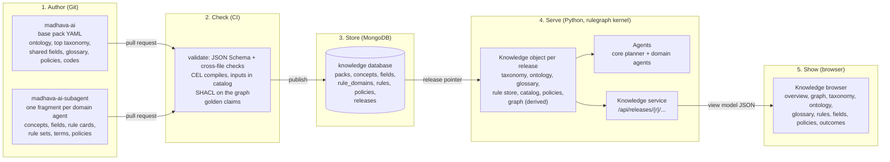
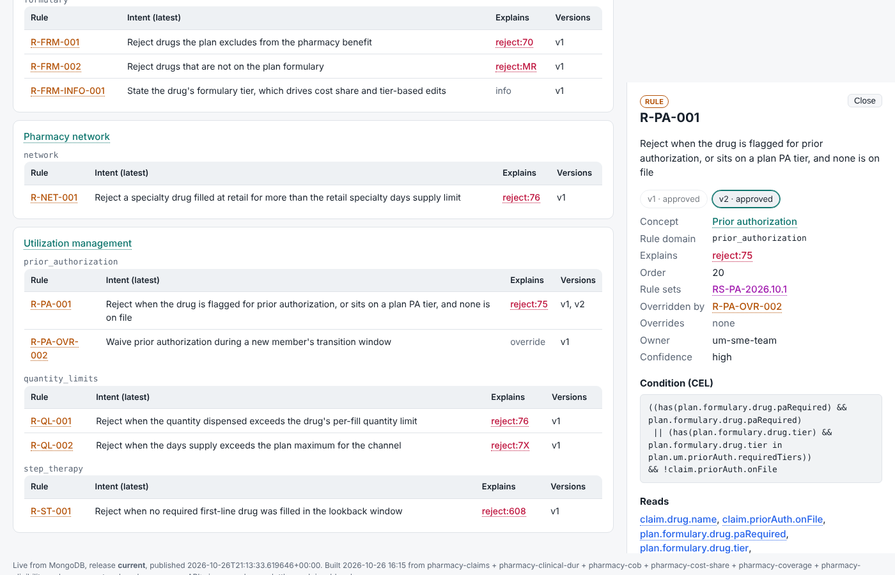
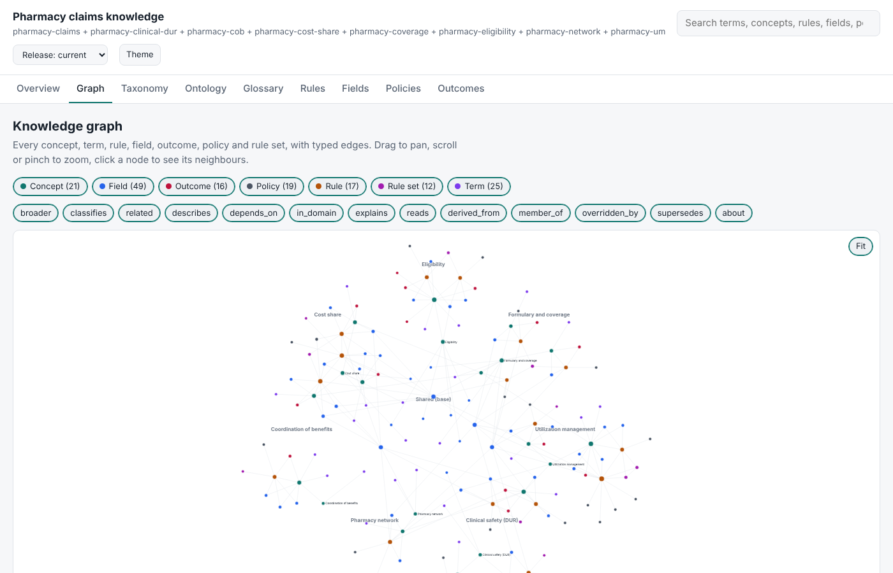
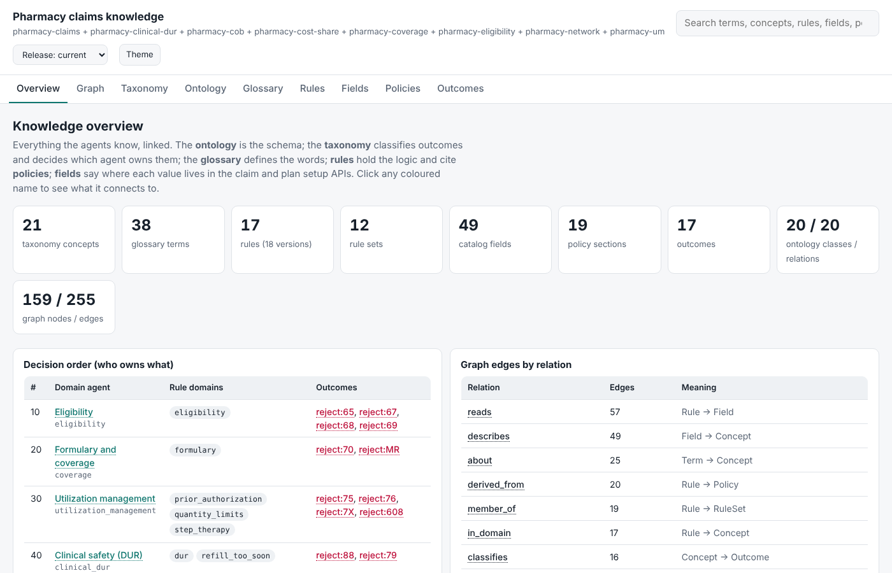
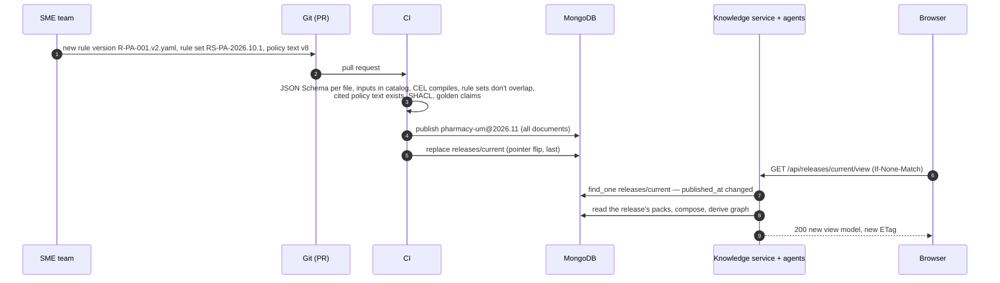

# The knowledge application: from authored files to the browser on screen

This document describes the knowledge side of the claim explanation system as a running application:

- where each kind of knowledge is written, stored and served;
- the exact format of each data element at every step;
- how the knowledge browser (`knowledge.html`) turns that data into what you see;
- how to run all of it on your machine.

It is written against the code in this repository (`kernel/src/rulegraph`) and the domain repository (`madhava-ai-subagent`). The examples are real documents taken from a local run.

Companion documents:
- [agent-system.md](agent-system.md): how the agents use this knowledge to answer questions.
- [viewing-knowledge.md](viewing-knowledge.md): the short how-to for the browser and the exports.

---

## 1. The application in one picture



Four rules keep the design simple:

1. **Git is the source of truth for authored knowledge.** People edit YAML files, one item per file or list entry. Reviews happen in pull requests. A future UI editor will write the same document shapes.
2. **MongoDB stores exactly what was authored, nothing derived.** Each document keeps the authored item unchanged under `doc` and adds a few lookup fields. A `releases` document names the pack versions the application runs.
3. **Everything derived is computed in memory when a release loads.** That covers the graph and its edges, the outcome list, "read by" and "derived from" lookups, decision order and agent grouping. The agents and the browser use the same `Knowledge` object, so the browser always shows exactly what the agents reason with.
4. **The browser renders one JSON view model.** The view model is the same whether it is embedded in a single offline HTML file (`madhava view`) or fetched from the knowledge service (`madhava knowledge-service`).

---

## 2. Components

| Component | What it is | Where it lives | Runs as |
|---|---|---|---|
| Base pack | Ontology, top of the taxonomy (one concept per domain agent with decision order), shared fields, shared glossary, shared policy text, reject code meanings | `madhava-ai/base/src/pharmacy_base/pack/` | Python package `pharmacy-base` |
| Domain fragments | Everything one domain agent owns: its concepts, fields, rule cards, rule sets, glossary terms and policy text | `madhava-ai-subagent/src/pharmacy_agents/packs/<agent>/` | Python package `pharmacy-agents`, one fragment per agent |
| Kernel | Loads, composes, validates, derives and exports knowledge; runs the agents; renders the browser; serves the API | `madhava-ai/kernel/src/rulegraph/` | Python package `rulegraph` |
| Knowledge store | Published packs and releases | MongoDB database `knowledge` | MongoDB 7 (Atlas in production, Docker locally) |
| Knowledge service | Read-only HTTP API plus the live browser | `rulegraph/service.py` | `madhava knowledge-service` |
| Knowledge browser | One HTML page, vanilla JavaScript, no CDN | `rulegraph/viewer.html` | Static page, embedded (offline) or served (live) |
| Agents | Core planner and domain agents | `src/madhava`, `madhava-ai-subagent` | `madhava ask`, `madhava serve` (A2A), `madhava mcp` |

---

## 3. The data elements

There are eight kinds of authored knowledge and two kinds of derived knowledge. Each section below covers:

- what the element is, and who owns it;
- **Git**: where it is written, and the JSON Schema that checks it;
- **MongoDB**: the stored document;
- **Derived**: what the kernel adds when a release loads;
- **View model**: what the browser receives;
- **Rendered**: what the tab shows;
- **Standard**: how it exports for other tools.

Ids in the view model use the form `kind:id`, for example `concept:um.prior_authorization`, `rule:R-PA-001`, `field:plan.costShare.copay`, `policy:Plan Setup Guide v8 / 4.2 Prior Auth`, `outcome:reject:75` and `ruleset:RS-PA-2026.10.1`. Graph nodes, links and the detail panel all use that same id.

### 3.1 Ontology: the schema of the knowledge

It defines what kinds of things exist (classes) and which relations may connect them. It has two parts:

- **Knowledge-graph classes:** Concept, Term, Rule, RuleSet, Policy, Field, Outcome, Finding, Evidence.
- **The claim data model the rules read:** Claim, ClaimResponse, Member, Drug, Pharmacy, ClaimHistory, Plan, PlanVersion, FormularyEntry, BenefitSetting, Accumulator.

Each class records the closest NCPDP or FHIR concept (`aligns_with`). The ontology is enforced in two places. Every field in the catalog must name one of these classes, and the graph builder refuses any edge whose relation, source type or target type is not declared here.

**Owner:** architecture or data modelling. It changes rarely.

**Git:** `base/src/pharmacy_base/pack/ontology/pharmacy.ontology.yaml`; schema `ontology.schema.json`.
```yaml
namespace: https://example.org/pharmacy/ontology#
version: "2026.10"
classes:
  Claim:
    description: A pharmacy claim transaction and its adjudication response.
    aligns_with: [NCPDP Telecommunication D.0 claim request/response, FHIR Claim, FHIR ExplanationOfBenefit]
  FormularyEntry:
    description: A drug's formulary status, tier and edits on a plan.
relations:
  - {name: reads,      domain: Rule,    range: Field}
  - {name: derived_from, domain: Rule,  range: Policy}
  - {name: supersedes, domain: RuleSet, range: RuleSet, aligns_with: prov:wasRevisionOf}
  - {name: about,      domain: Term,    range: Concept, aligns_with: skos:closeMatch}
```

**MongoDB:** the ontology is not a collection of its own. It is stored inside the base pack's document in `packs`, under `ontology`.

**View model:**
```json
"ontology": {
  "classes":   [{"name": "Claim", "description": "...", "aligns": ["NCPDP ...", "FHIR Claim"]}],
  "relations": [{"name": "reads", "domain": "Rule", "range": "Field", "aligns": null}]
}
```

**Rendered:** the Ontology tab draws a diagram with the knowledge-graph classes in fixed positions on top and the claim data model below, arranged around Claim. Under the diagram are a class table and a relation table, and every class and relation opens the detail panel.

**Standard:** OWL and RDFS as JSON-LD (`export ontology`), also embedded in `export graph`.

### 3.2 Taxonomy: the classification tree, which also decides who owns what

It is a SKOS concept scheme with three levels:

- **Top concepts** are the domain agents. Each carries `agent` and `precedence`. Precedence is the adjudication order used to pick the primary reason when several rules fire.
- **Leaf concepts** carry `rule_domain`, the unit in which rules are authored and released. They also carry `notations`, the outcome tokens they classify, such as `reject:75`.
- **`altLabels`** are the words people use, and are how free-text questions are routed.

**Owner:** the base pack owns the top concepts. Each domain repository owns the concepts under its own top concept.

**Git:** base `pack/taxonomy/adjudication.taxonomy.yaml` (scheme plus top concepts); domain `packs/<agent>/taxonomy/concepts.yaml`; schema `concept.schema.json`.
```yaml
# base
scheme: {id: "pharmacy:adjudication", prefLabel: Pharmacy claim adjudication, version: "2026.10"}
concepts:
- {id: um, prefLabel: Utilization management, agent: utilization_management, precedence: 30,
   definition: Clinical and quantity controls applied before a drug is paid., altLabels: [utilization management, um]}
# fragment (madhava-ai-subagent/.../utilization_management/taxonomy/concepts.yaml)
concepts:
- id: um.prior_authorization
  broader: um
  prefLabel: Prior authorization
  definition: Approval required from the plan before the drug is covered.
  rule_domain: prior_authorization
  notations: [reject:75]
  altLabels: [prior authorization, prior auth, pa, authorization]
  related: [coverage.tier]
```

**MongoDB:** the `concepts` collection with `scheme: "taxonomy"`. The scheme header itself is stored in the base pack's `packs` document.
```json
{ "_id": "pharmacy-um@2026.10:taxonomy:um.prior_authorization",
  "pack": "pharmacy-um", "pack_version": "2026.10", "scheme": "taxonomy",
  "doc": { "id": "um.prior_authorization", "broader": "um", "prefLabel": "Prior authorization",
           "definition": "Approval required from the plan before the drug is covered.",
           "rule_domain": "prior_authorization", "notations": ["reject:75"],
           "altLabels": ["prior authorization", "prior auth", "pa", "authorization"], "related": ["coverage.tier"] } }
```

**Derived:** `narrower`, inverted from `broader`; the owning agent of every concept, found by walking up to the top concept; precedence inherited from the top concept; and the rules in each concept.

**View model:**
```json
{"id": "um.prior_authorization", "label": "Prior authorization", "definition": "...", "broader": "um",
 "narrower": [], "related": ["coverage.tier"], "alt": ["prior auth", "pa", "..."], "notations": ["reject:75"],
 "agent": "utilization_management", "isTop": false, "precedence": 30, "ruleDomain": "prior_authorization",
 "rules": ["R-PA-001", "R-PA-OVR-002"]}
```

**Rendered:** the Taxonomy tab is a tree of top concepts in decision order. Each leaf shows its rule domain, outcome tokens and rules. The Overview tab's "Decision order" table also comes from the top concepts.

**Standard:** SKOS JSON-LD (`export taxonomy`).

### 3.3 Glossary: words and abbreviations

The glossary defines terms people use in questions and answers (PA, OCC, DOS, accumulator). It is a second SKOS scheme. Each term can point at the taxonomy concepts it is about, and those links become `about` edges in the graph. The agents answer "what does X mean?" from it. Code meanings such as "Reject code 75" are generated from the reject code table, not authored twice.

**Owner:** the base pack holds shared terms; each domain holds its own terms.

**Git:** base `pack/glossary/glossary.yaml` (scheme plus terms); domain `packs/<agent>/glossary/terms.yaml`; schemas `glossary.schema.json` and `term.schema.json`.
```yaml
terms:
- id: prior-authorization
  prefLabel: Prior authorization
  definition: Approval the plan requires before it will pay for certain drugs.
  altLabels: [PA, prior auth, preauthorization]
  concepts: [um.prior_authorization]
  example: A tier 4 GLP-1 rejects with 75 until a prior authorization is on file.
```

**MongoDB:** the `concepts` collection again, with `scheme: "glossary"`. Taxonomy and glossary concepts share one collection because both are SKOS concepts. `_id` is `pharmacy-um@2026.10:glossary:prior-authorization`, and `doc` is the term exactly as written above.

**Derived:** a `code-<value>` term for every reject code, with `kind: "code"`.

**View model:**
```json
{"id": "prior-authorization", "label": "Prior authorization", "definition": "...", "alt": ["PA", "prior auth"],
 "concepts": ["um.prior_authorization"], "kind": "term", "notation": null, "example": "...", "source": null}
```

**Rendered:** the Glossary tab lists terms with a filter box, showing abbreviations, definitions, examples and linked concepts. A "Show code meanings" switch adds the code terms.

**Standard:** SKOS JSON-LD (`export glossary`).

### 3.4 Field catalog: where every value lives

The catalog describes every value a rule may read. There are two sources:

- **`record` fields** come from the claim.
- **`reference` fields** come from the plan setup API, located by a JSON Pointer into its payload. `params` fill the pointer from other fields, for example tier and channel. This is how an agent fetches the 3 or 4 values a rule needs out of roughly 12,000.

Every field names an ontology class (`entity`) and a taxonomy concept. When a field has an NCPDP field number, it carries it as `ncpdp`.

**Owner:** the base pack holds shared fields such as claim id, date of service and drug. Each domain holds the fields only its rules read.

**Git:** base `pack/catalog/fields.yaml`; domain `packs/<agent>/catalog/fields.yaml`; schema `field.schema.json`. The schema requires `pointer` when `source: reference`.
```yaml
- path: plan.costShare.copay
  source: reference
  entity: BenefitSetting
  type: number
  pointer: /costShare/tiers/{tier}/{channel}/copay
  params: {tier: plan.formulary.drug.tier, channel: claim.pharmacy.channel}
  concept: cost_share.copay
  description: Copay for the drug's tier and channel
- path: claim.quantity
  source: record
  entity: Claim
  type: number
  ncpdp: 442-E7
  concept: um.quantity_limits
  description: Quantity dispensed
```

**MongoDB:** the `fields` collection, one document per field.
```json
{ "_id": "pharmacy-cost-share@2026.10:plan.costShare.copay", "pack": "pharmacy-cost-share", "pack_version": "2026.10",
  "doc": { "path": "plan.costShare.copay", "source": "reference", "entity": "BenefitSetting", "type": "number",
           "pointer": "/costShare/tiers/{tier}/{channel}/copay",
           "params": {"tier": "plan.formulary.drug.tier", "channel": "claim.pharmacy.channel"},
           "concept": "cost_share.copay", "description": "Copay for the drug's tier and channel" } }
```

**Derived:** `readBy` (the rules whose inputs include the field); `describes` edges (field to concept); and `depends_on` edges (field to each field in `params`).

**View model:** `{"path", "source", "entity", "type", "concept", "description", "pointer", "params", "readBy": ["R-CS-001"], "ncpdp"}`.

**Rendered:** the Fields tab is a table of path, source, entity, type, JSON Pointer with parameters, concept and the rules that read it.

### 3.5 Rule cards: the logic

A rule card is one versioned business rule. It holds:

- what the rule reads (`record_inputs`, `reference_inputs`);
- its CEL `condition`, which the evaluator runs on real values (never the LLM);
- the outcome it explains (`reject 75`, a price component, `info` or `override`);
- the wording template;
- the rules that override it, and its order;
- the policy sections it comes from (`source_refs`);
- its owner and status.

A new version is a new file. Old versions are never edited, so old claims can still be explained with the rule that applied then.

**Owner:** the SME team of the rule domain.

**Git:** `packs/<agent>/domains/<rule_domain>/rules/<ID>.v<N>.yaml`; schema `rule-card.schema.json`.
```yaml
id: R-PA-001
version: 2
status: approved
domain: prior_authorization
concept: um.prior_authorization
intent: Reject when the drug is flagged for prior authorization, or sits on a plan PA tier, and none is on file
outcome: {type: reject, code: "75"}
record_inputs: [claim.drug.name, claim.priorAuth.onFile]
reference_inputs: [plan.formulary.drug.paRequired, plan.formulary.drug.tier, plan.um.priorAuth.requiredTiers]
condition: >
  ((has(plan.formulary.drug.paRequired) && plan.formulary.drug.paRequired)
   || (has(plan.formulary.drug.tier) && plan.formulary.drug.tier in plan.um.priorAuth.requiredTiers))
  && !claim.priorAuth.onFile
order: 20
overridden_by: [R-PA-OVR-002]
template: >
  {{claim.drug.name}} needs prior authorization on this plan: ...
source_refs: [{doc: Plan Setup Guide v8, section: "4.2 Prior Auth"}, {doc: ENG-REL-4412 release notes}]
confidence: high
sme_owner: um-sme-team
```

**MongoDB:** the `rules` collection, one document per version. `rule_id` and `domain` are copied out of `doc` so they can be indexed.
```json
{ "_id": "pharmacy-um@2026.10:R-PA-001@2", "pack": "pharmacy-um", "pack_version": "2026.10",
  "domain": "prior_authorization", "rule_id": "R-PA-001",
  "doc": { "id": "R-PA-001", "version": 2, "status": "approved", "...": "exactly the YAML above" } }
```

**Derived:**
- the outcome token (`reject:75`);
- graph edges: `explains` (rule to outcome), `in_domain` (rule to concept), `reads` (rule to each input field), `overridden_by`, `derived_from` (rule to each cited policy section) and `member_of` (rule to each rule set that contains this version);
- `overrides`, the reverse of `overridden_by`;
- the owning agent.

**View model:** one entry per rule id, with every version.
```json
{"id": "R-PA-001", "domain": "prior_authorization", "concept": "um.prior_authorization",
 "agent": "utilization_management", "overrides": [],
 "versions": [{"version": 2, "status": "approved", "intent": "...", "condition": "...",
               "recordInputs": ["claim.drug.name", "claim.priorAuth.onFile"], "referenceInputs": ["..."],
               "outcome": {"type": "reject", "code": "75"}, "token": "reject:75",
               "overriddenBy": ["R-PA-OVR-002"], "template": "...", "order": 20, "confidence": "high",
               "owner": "um-sme-team", "sources": ["Plan Setup Guide v8 / 4.2 Prior Auth", "ENG-REL-4412 release notes"],
               "rulesets": ["RS-PA-2026.10.1"]}]}
```

**Rendered:** the Rules tab groups rules by agent and then by rule domain, in tables of rule, latest intent, outcome and versions. Clicking a rule opens the detail panel shown below. It has version tabs, the concept, outcome, order, rule sets, overrides, owner, the CEL condition, the fields it reads, the wording, and the full text of each cited policy section.



### 3.6 Rule sets: which rule versions were in force when

A rule set is an effective-dated release of one rule domain. It lists exact rule versions (`R-PA-001@2`) and points to the rule set it replaced. Old claims are explained with the rule set that was in force on their date of service.

**Git:** `packs/<agent>/domains/<rule_domain>/domain.yaml`; schema `rule-domain.schema.json`. Validation rejects overlapping date ranges.
```yaml
domain: prior_authorization
concepts: [um.prior_authorization]
owner: um-sme-team
releases:
  - {id: RS-PA-2026.01.1, effective_from: "2026-01-01", effective_to: "2026-10-01", status: archived,
     change_ref: ENG-REL-4001, reason: Baseline prior authorization rules, rules: [R-PA-001@1, R-PA-OVR-002@1]}
  - {id: RS-PA-2026.10.1, effective_from: "2026-10-01", effective_to: null, status: active,
     change_ref: ENG-REL-4412, previous: RS-PA-2026.01.1,
     reason: Prior authorization now applies to every drug on a plan PA tier, rules: [R-PA-001@2, R-PA-OVR-002@1]}
```

**MongoDB:** the `rule_domains` collection, one document per rule domain. `_id` is `pharmacy-um@2026.10:prior_authorization`, and `doc` holds the YAML above without the rules, which live in `rules`.

**Derived:** `member_of` (rule version to rule set) and `supersedes` (rule set to `previous`).

**View model:** `"rulesets": [{"id", "domain", "owner", "from", "to", "status", "reason", "previous", "rules": ["R-PA-001@2"]}]`.

**Rendered:** the Overview tab has a "Rule set changes" list, and a rule set opens in the detail panel. In the RDF export it becomes `prov:wasRevisionOf`.

### 3.7 Policy text: where each rule comes from

Policy text holds the sections of source documents (plan setup guides, release notes, the reject code table) that rules cite. A rule cites `{doc, section}`. The section's key is `"doc / section"`, or just `doc` when there is no section. Answers carry this text as their sources. Validation fails if a rule cites a section that has no text, once any policies are loaded.

**Owner:** the SME team that owns the source document. The texts in the reference implementation are marked `sample: true`.

**Git:** base `pack/policies/policies.yaml`; domain `packs/<agent>/policies/policies.yaml`; schema `policy.schema.json`.
```yaml
- doc: Plan Setup Guide v8
  section: 4.2 Prior Auth
  title: Prior authorization (from 2026-10-01)
  text: Prior authorization applies to drugs flagged individually and to every drug on a tier the plan lists as
    a prior authorization tier. Without an approved authorization on file, the claim rejects with 75.
  owner: um-sme-team
  version: '8'
  effective_from: '2026-10-01'
  sample: true
```

**MongoDB:** the `policies` collection, with `_id` `pharmacy-um@2026.10:Plan Setup Guide v8 / 4.2 Prior Auth` and `doc` as above.

**Derived:** `derived_from` edges, and each section's list of rules.

**View model:** `{"key", "doc", "section", "title", "text", "owner", "version", "effective", "sample", "rules": ["R-PA-001"]}`.

**Rendered:** the Policies tab lists one card per section, with its text and the rules derived from it. The same text also appears inside every rule that cites it.

**Standard:** PROV-O. Each rule version is `prov:wasDerivedFrom` its policy sections.

### 3.8 Reject codes (part of the base pack)

The reject code table maps NCPDP codes to their meanings. It is stored as `{code, meaning}` pairs in the base pack's `packs` document under `codes`. It feeds outcome meanings and the generated glossary code terms.

```yaml
# base/src/pharmacy_base/pack/catalog/reject_codes.yaml
codes:
  "75": Prior Authorization Required
  "76": Plan Limitations Exceeded
```

### 3.9 Outcomes (derived)

An outcome is one observable result of adjudication, written as a token: `reject:<code>` or `price:<component>`. Outcomes are never authored as their own documents. Their sources are concept `notations`, rule outcomes and the reject code table.

**View model:** `{"token": "reject:75", "meaning": "Prior Authorization Required", "concept": "um.prior_authorization", "rules": ["R-PA-001"]}`.

**Rendered:** the Outcomes tab is a table of token, meaning, classifying concept and explaining rules. A token with no rules is a gap: something adjudication can produce that no rule explains yet. That is the SME backlog.

### 3.10 The knowledge graph (derived)

The graph is not stored. The kernel builds it from the elements above every time a release loads, and checks each edge against the ontology.

| Relation | From → to | Built from | Used by the agents' rule search? |
|---|---|---|---|
| `broader` | Concept → Concept | concept `broader` | yes |
| `related` | Concept → Concept | concept `related` | yes |
| `classifies` | Concept → Outcome | concept `notations` | yes |
| `explains` | Rule → Outcome | rule `outcome` | yes |
| `in_domain` | Rule → Concept | rule `concept` | yes |
| `reads` | Rule → Field | rule `record_inputs`, `reference_inputs` | yes |
| `overridden_by` | Rule → Rule | rule `overridden_by` | yes |
| `derived_from` | Rule → Policy | rule `source_refs` | yes |
| `describes` | Field → Concept | field `concept` | yes |
| `depends_on` | Field → Field | field `params` | no (structural) |
| `member_of` | Rule → RuleSet | rule domain `releases[].rules` | no (structural) |
| `supersedes` | RuleSet → RuleSet | rule domain `releases[].previous` | no (structural) |
| `about` | Term → Concept | term `concepts` | no (structural) |

Structural edges are shown and exported, but the agents' weighted walk from a claim's outcome tokens never follows them. A test enforces this.

Every node also gets a **group** for the graph layout: the domain agent it belongs to, or `shared` for base-level knowledge used by several agents.

**View model:**
```json
"graph": {
  "nodes":  [{"id": "rule:R-PA-001", "kind": "rule", "label": "R-PA-001", "group": "utilization_management"}],
  "edges":  [["rule:R-PA-001", "explains", "outcome:reject:75"], ["rule:R-PA-001", "reads", "field:claim.priorAuth.onFile"]],
  "groups": [{"id": "eligibility", "label": "Eligibility"}, {"id": "coverage", "label": "Formulary and coverage"}]
}
```
`groups` is in decision order (precedence 10, 20, 30, …).

**Rendered:** the Graph tab, described in section 6.

**Standards:**
- RDF as Turtle or JSON-LD (`export graph`), using classes and properties from the ontology namespace;
- SKOS for concepts and terms;
- PROV-O for sources and rule set history;
- SHACL shapes the graph must satisfy (`export shapes`, `madhava shacl`);
- GraphML for yEd, Gephi or Cytoscape.

The full graph exports to about 2,000 RDF triples.



---

## 4. The MongoDB knowledge store

### 4.1 Collections

| Collection | One document per | `_id` | Indexed fields |
|---|---|---|---|
| `packs` | pack version | `pharmacy-um@2026.10` | `_id` |
| `concepts` | taxonomy concept or glossary term | `<pack>@<ver>:taxonomy:<id>`, `<pack>@<ver>:glossary:<id>` | `pack`+`pack_version`, `scheme` |
| `fields` | catalog field | `<pack>@<ver>:<path>` | `pack`+`pack_version` |
| `rule_domains` | rule domain, with its rule sets | `<pack>@<ver>:<domain>` | `pack`+`pack_version` |
| `rules` | rule version | `<pack>@<ver>:<rule id>@<version>` | `pack`+`pack_version`, `rule_id` |
| `policies` | policy section | `<pack>@<ver>:<doc / section>` | `pack`+`pack_version` |
| `releases` | named release | `current`, `pilot-um`, … | `_id` |

Every document except `packs` and `releases` has the same envelope: `pack`, `pack_version`, any lookup fields, and `doc`, the authored item unchanged. The authored shape is therefore validated by the same JSON Schemas whether it comes from a file or from the database.

The `packs` document carries the pack-level parts: `manifest` (the pack's `pack.yaml`), `kind` (`base` or `fragment`), `extends`, `scheme` and `glossary_scheme` (the SKOS scheme headers), `ontology` (base only), `codes`, and the procedures `investigator`, `domain_planner` and `intents`.

A local run produced these counts: `packs` 8, `concepts` 59, `fields` 49, `rule_domains` 11, `rules` 18, `policies` 19, `releases` 2.

### 4.2 Releases: what the application runs

```json
{ "_id": "current",
  "packs": [ {"name": "pharmacy-claims", "version": "2026.10", "kind": "base"},
             {"name": "pharmacy-um",     "version": "2026.10", "kind": "fragment"},
             "..." ],
  "note": "All domains, from 7bae751",
  "published_at": "2026-10-26T21:13:33.619646+00:00" }
```

- **Publishing is write-then-flip.** `publish` upserts every document of every pack version first, then replaces the release document last. A reader never sees half a release.
- **Pack versions are immutable in practice.** A domain team publishes `pharmacy-um@2026.11` next to `@2026.10`. Rolling back means pointing the release at the older version again. Nothing is deleted.
- **Several releases can exist side by side.** For example, `current` for production, `pilot-um` for a pilot, and `candidate` for testing a change before it goes live. The browser has a release picker.

### 4.3 Reading a release back

`rulegraph.adapters.mongodb.mongo_sources(db, "current")` returns one `MongoSource` per pack, base first. `Knowledge.compose(sources)` builds exactly what `DirectorySource` builds from files, and a test checks the round trip gives an identical graph. Composition rejects any conflict, such as two packs defining the same concept, term, field, rule or policy section, and does not quietly let one win.

### 4.4 What is not in MongoDB

- **Derived things:** the graph, outcomes, lookups and the view model. They are cheap to compute (well under a second here) and can never drift from their sources.
- **Claims and plan setup data.** These stay in their systems of record. Agents fetch only the fields a rule needs, at question time.
- **Explanations, episodic memory and coverage gaps.** These belong in separate operational collections or stores with their own retention, and are outside this document.

---

## 5. The knowledge service (read API)

`madhava knowledge-service` (or `rulegraph … knowledge-service`, or `pharmacy-domains knowledge-service`) starts a small read-only HTTP server built on the Python standard library. The logic is in `KnowledgeService.handle()` and is independent of HTTP plumbing, so the same class can be mounted in FastAPI or called behind any gateway.

```bash
madhava knowledge-service --mongo mongodb://127.0.0.1:27017            # every release in MongoDB, default "current"
madhava knowledge-service                                               # the pack files on disk (release "files")
```

### 5.1 Endpoints

| GET | Returns | Used by |
|---|---|---|
| `/` | the knowledge browser in live mode | people |
| `/api/health` | `{ok, source, defaultRelease}` | probes |
| `/api/releases` | `{default, releases: [{release, source, packs, note, publishedAt, default}]}` | release picker |
| `/api/releases/{r}/view` | the whole view model (section 6.1); `ETag`, `Cache-Control: no-cache`; `304` when unchanged | the browser |
| `/api/releases/{r}/meta`, `concepts`, `terms`, `ontology`, `rules`, `rulesets`, `fields`, `policies`, `outcomes` | one section of the view model | other UIs, scripts |
| `/api/releases/{r}/rules/{id}` | the rule with every version, plus `policyText` and `ruleSets` resolved | rule pages, review tools |
| `/api/releases/{r}/graph?agent=&focus=&depth=` | the whole graph, one agent's sector plus the shared nodes it touches, or a neighbourhood of `depth` hops around `focus` | large graphs, embedding |
| `/api/releases/{r}/search?q=&limit=` | `[{kind, id, label, node}]` ranked: label prefix, then label contains, terms first | global search |
| `/api/releases/{r}/export/{name}` | `graph.jsonld`, `graph.ttl`, `taxonomy.jsonld`, `glossary.jsonld`, `ontology.jsonld`, `shapes.ttl`, `knowledge.graphml` | Protégé, GraphDB, yEd |

Unknown releases, rules, nodes or sections return `404` with `{"error": "..."}`.

### 5.2 Loading, caching and picking up a new publish

- **The first request for a release builds it.** The service loads the `Knowledge` object through `mongo_sources` and `Knowledge.compose`, builds the view model, and caches both under the release's `published_at` stamp.
- **Every request checks one small document.** It reads the release document (`find_one` by `_id`). If `published_at` has changed, the release is rebuilt. A new publish therefore shows up on the next request with no restart and no polling loop.
- **The `ETag` is derived from the release and its stamp.** Browsers revalidate with `If-None-Match` and get `304` until the next publish.
- **In production**, you can replace the per-request check with a MongoDB change stream on `releases` (Atlas supports it). You can also put the `/view` response in Redis or a CDN keyed by the ETag. The view model changes only on publish.

### 5.3 Example calls

```bash
curl -s localhost:8300/api/releases | jq '.releases[].release'
curl -s localhost:8300/api/releases/current/rules/R-PA-001 | jq '{id, versions: [.versions[].version], ruleSets: (.ruleSets|keys)}'
curl -s 'localhost:8300/api/releases/current/graph?focus=rule:R-PA-001&depth=1' | jq '.nodes[].id'
curl -s 'localhost:8300/api/releases/current/search?q=prior%20auth' | jq '.[].node'
curl -s localhost:8300/api/releases/current/export/graph.ttl > knowledge.ttl
```

---

## 6. How the browser renders the data

### 6.1 The view model: one contract for both modes

`rulegraph.viewer.view_data(knowledge)` produces the view model, and nothing else feeds the page:

```text
meta      title, pack, origin (composed packs), generated, recordNoun ("claim"), referenceNoun ("plan setup"),
          taxonomyScheme, glossaryScheme, namespace
          + live mode: release, source ("mongodb" | "files"), publishedAt, packs, releases
concepts  [{id, label, definition, broader, narrower[], related[], alt[], notations[], agent, isTop, precedence,
            ruleDomain, rules[]}]
terms     [{id, label, definition, alt[], concepts[], kind ("term" | "code"), notation, example, source}]
ontology  {classes: [{name, description, aligns[]}], relations: [{name, domain, range, aligns}]}
rules     [{id, domain, concept, agent, overrides[], versions: [{version, status, intent, condition, recordInputs[],
            referenceInputs[], outcome, token, overriddenBy[], template, order, confidence, owner, sources[], rulesets[]}]}]
rulesets  [{id, domain, owner, from, to, status, reason, previous, rules[]}]
fields    [{path, source, entity, type, concept, description, pointer, params, readBy[], ncpdp?}]
policies  [{key, doc, section, title, text, owner, version, effective, sample, rules[]}]
outcomes  [{token, meaning, concept, rules[]}]
graph     {nodes: [{id, kind, label, group}], edges: [[src, rel, dst]], groups: [{id, label}]}
```

For the full pharmacy knowledge this is about 110 KB of JSON: 21 concepts, 52 terms, 17 rules, 12 rule sets, 49 fields, 19 policy sections, 17 outcomes, and 159 nodes with 255 edges.

### 6.2 Two ways to deliver it

| | Offline file | Live from the service |
|---|---|---|
| Command | `madhava view --out knowledge.html` | `madhava knowledge-service [--mongo URI]` then open `http://127.0.0.1:8300/` |
| Data | embedded in `<script id="data" type="application/json">` | that block holds `null`; the page calls `GET api/releases` and then `GET api/releases/{r}/view` |
| Release | the files at the time you ran it | picker in the header, `?release=` in the URL |
| Footer | "Generated … from …" | "Live from MongoDB, release …, published …" with API links |
| Use | email it, attach it to a ticket, review offline | the running application |

A snapshot of the offline file is committed at [`docs/knowledge.html`](knowledge.html).

The page code is the same file (`rulegraph/viewer.html`) in both modes. On load it reads the data block, and if that is `null` it fetches the view model before rendering anything.

### 6.3 What each tab reads and draws

The page builds lookup maps once (`C` concepts by id, `T` terms, `R` rules, `F` fields, `P` policies, `O` outcomes, `RS` rule sets, plus ontology classes and relations). Each tab is then a function of those maps that returns HTML. Routing is by URL hash (`#/rules`), so every tab can be bookmarked.

| Tab | Reads | Draws |
|---|---|---|
| Overview | array lengths; `concepts` where `isTop`, sorted by `precedence`; `graph.edges` counted by relation; `rulesets` with `previous` | Count tiles; the "Decision order" table (agent, rule domains, outcomes); edges by relation with their meaning (from the ontology); rule set changes |
| Graph | `graph.nodes`, `graph.edges`, `graph.groups` | An SVG force layout (below). Filter chips per node kind and relation; drag to pan; wheel or pinch to zoom; Fit button; clicking a node dims all but its neighbours and opens its detail |
| Taxonomy | `concepts` (`isTop`, `narrower`, `notations`, `ruleDomain`, `rules`) | A tree per top concept in decision order; leaves show rule domain pills, outcome links and rule links |
| Ontology | `ontology.classes`, `ontology.relations` | A diagram with knowledge-graph classes in a fixed arrangement on top and the claim data model around Claim below; class and relation tables |
| Glossary | `terms` (`kind`) | A filterable list: label, abbreviations, definition, example, linked concepts; "Show code meanings" adds code terms |
| Rules | `rules`, grouped by `agent` then `domain` | Tables of rule, latest intent, outcome and versions; the detail panel shown in 3.5 |
| Fields | `fields` | A table of path, source, entity, type, pointer with parameters, concept and "read by" rules |
| Policies | `policies` | A card per section with title, text, owner, version, effective date, sample flag and derived rules |
| Outcomes | `outcomes` | A table of token, meaning, concept and rules; outcomes with no rule are marked as gaps |

**The detail panel.** Any coloured name is a link to a `kind:id`. Clicking it opens the right-hand panel, or a bottom sheet on narrow screens, showing the item and its neighbours from both directions. For example, a field shows its concept, its parameters, the fields it depends on, and the rules that read it.

**Search.** The search box indexes labels, alternative labels, definitions, intents, policy text and rule set reasons across every kind. Results are ranked by label prefix, then label contains, then terms first, and Enter opens the top hit. `GET /api/releases/{r}/search` applies the same ranking on the server.

**The graph layout.** The layout is deterministic, so the picture is the same on every load.
1. Each domain agent in `graph.groups` gets an anchor point on a circle, clockwise from the top in decision order. `shared` sits at the centre.
2. Nodes start near their group's anchor, placed by a seeded random generator.
3. The layout runs 420 force iterations: short-range repulsion between all nodes; springs along edges, strong inside a group and weak across groups; and a pull towards each node's own anchor. The step size decreases each iteration.
4. Group labels are drawn at the anchors, and node colour comes from the node kind.

At this size (159 nodes) the layout takes a few hundred milliseconds in the browser. For thousands of rules, have the UI ask the service for `?agent=` or `?focus=&depth=` and draw only that part.

**Theme and accessibility.** The page has light and dark themes (following the system setting, with a toggle). Links and buttons are real `<a>` and `<button>` elements, and wide tables scroll inside their box.



### 6.4 Moving to a React application

The page is deliberately framework-free so it can be opened as a single file. A production UI in React (or any framework) keeps the same contract:

- **Data:** fetch `GET /api/releases/{r}/view` once per release with React Query or SWR, honouring the ETag. Build the same lookup maps in a memo.
- **Routes:** one route per tab plus `/:kind/:id` for the detail panel. The `kind:id` ids map straight onto routes.
- **Graph:** keep the anchor-per-agent layout (d3-force can do the same with `forceX`/`forceY` to anchors), or Cytoscape.js with a preset layout. Move to `/graph?agent=` when the graph gets large.
- **Search:** call `/search` from the server, or keep the client index for instant results.
- **Editing (later):** an authoring UI writes the same `doc` shapes as drafts. Drafts are validated with the same JSON Schemas (`rulegraph schemas` exports them) and published as a new pack version. The browser itself stays read-only.

---

## 7. How a change reaches the screen



To roll back, point `current` at the previous pack version (re-run `publish` from the previous commit, or update the release document). Nothing else changes.

---

## 8. Running it locally

### 8.1 One command

On macOS or Linux, with Python 3.11 or newer, Git and (optionally) Docker:

```bash
mkdir -p ~/Developer/AI/madhava-ai && cd ~/Developer/AI/madhava-ai
git clone -b knowledge-standards https://github.com/Satveerskhaira/madhava-ai.git   # plain clone once PR #6 is merged
./madhava-ai/scripts/run-local.sh
```

The script:
1. clones `madhava-ai-subagent` next to `madhava-ai`, and checks out `knowledge-standards` in both while that branch exists, otherwise `main`;
2. creates one virtual environment at `~/Developer/AI/madhava-ai/.venv` and installs the kernel, pharmacy base, domain agents and core agent, all editable, so changes in either repo take effect immediately;
3. runs the test suites of both repos, then `madhava validate`, `madhava eval` (13 golden claims) and `madhava shacl`;
4. writes `out/knowledge.html` (the offline browser) and every export to `~/Developer/AI/madhava-ai/out/`;
5. starts MongoDB 7 with `docker compose up -d mongo`, unless something already answers on 27017;
6. publishes two releases: `current` (base plus all seven domains) and `pilot-um` (base plus utilization management);
7. starts the knowledge service on `http://127.0.0.1:8300/` and opens it in your browser.

Resulting layout:
```
~/Developer/AI/madhava-ai/
├── madhava-ai/            core agent, kernel, pharmacy base, docs
├── madhava-ai-subagent/   seven domain agents
├── .venv/                 shared Python environment
└── out/                   knowledge.html, knowledge.ttl, knowledge.jsonld, taxonomy/glossary/ontology.jsonld,
                           shapes.ttl, knowledge.graphml
```

Options: `BRANCH=main`, `SKIP_TESTS=1`, `NO_MONGO=1` (serve from the files), `MONGO_URI=mongodb://…` (use your own MongoDB), `PORT=8300`, `NO_SERVE=1`.

### 8.2 Step by step, by hand

```bash
cd ~/Developer/AI/madhava-ai
python3 -m venv .venv && source .venv/bin/activate
pip install -e "madhava-ai/kernel[adk,mcp,rdf,mongo,dev]" -e "madhava-ai/base[dev]" \
            -e "madhava-ai-subagent[dev]" -e "madhava-ai[dev]"

madhava validate && madhava eval && madhava shacl          # checks
madhava view                                               # offline browser, opens knowledge.html

docker compose -f madhava-ai/docker-compose.yml up -d mongo
madhava publish --uri mongodb://127.0.0.1:27017 --release current
madhava knowledge-service --mongo mongodb://127.0.0.1:27017 --open
```

Ask the agents a question with the same knowledge:
```bash
madhava ask RX-1001 "Why was this rejected, and what would it cost if approved?"
madhava ask RX-1007 "Why did this reject?" --trace
```

### 8.3 Look inside MongoDB

Open **MongoDB Compass**, connect to `mongodb://127.0.0.1:27017` and open database `knowledge`. Good first queries:

| Collection | Filter | Shows |
|---|---|---|
| `releases` | `{}` | what each release runs |
| `rules` | `{rule_id: "R-PA-001"}` | both versions of the prior authorization rule |
| `concepts` | `{scheme: "glossary", "doc.altLabels": "PA"}` | the glossary entry for PA |
| `fields` | `{"doc.source": "reference"}` | every plan setup field with its JSON Pointer |
| `policies` | `{pack: "pharmacy-um"}` | policy text owned by the utilization management team |

Publish a change and watch it arrive: edit a rule's `intent` in `madhava-ai-subagent`, run `madhava publish --uri mongodb://127.0.0.1:27017 --release current`, then reload the browser. The service sees the new `published_at` and rebuilds.

### 8.4 Without Docker

- **Use an existing MongoDB:** `MONGO_URI=mongodb://host:27017 ./madhava-ai/scripts/run-local.sh`. Homebrew users can run `brew tap mongodb/brew && brew install mongodb-community@7.0 && brew services start mongodb-community@7.0`.
- **Skip the database entirely:** `NO_MONGO=1 ./madhava-ai/scripts/run-local.sh`. The service then reads the pack files and shows the single release `files`.
- **MongoDB-compatible servers work as well.** The reference run behind this document used FerretDB.

### 8.5 Troubleshooting

| Symptom | Fix |
|---|---|
| `Python 3.11 or newer is required` | `brew install python@3.12`, then re-run |
| `docker compose could not start MongoDB` | Start Docker Desktop, or use `MONGO_URI` or `NO_MONGO=1` |
| Port 8300 in use | `PORT=8400 ./madhava-ai/scripts/run-local.sh` |
| `release 'current' is not published` | Run `madhava publish --uri … --release current` |
| Browser shows "Could not load the knowledge" | The page was opened as a file in live mode; open it through the service URL instead |
| `madhava shacl` says rdflib is missing | Install with the `rdf` extra: `pip install -e "madhava-ai/kernel[rdf]"` |

---

## 9. Production shape

| Concern | Choice |
|---|---|
| Store | MongoDB Atlas, database `knowledge`. CI is the only writer. Services read only, through a role limited to `find`. Back up `releases` with everything else. |
| Service | Knowledge service as its own small deployment on GKE behind the internal gateway, or the same `KnowledgeService` class mounted inside the agent service. It holds no state except the per-release cache. |
| Freshness | Per-request `published_at` check (one indexed `find_one`), or a change stream on `releases`. ETag for clients. Optionally cache `/view` in Redis or a CDN keyed by ETag. |
| Security | Knowledge contains no PHI: rules, field paths, policy text and definitions only. Even so, put the browser behind SSO, and keep exports internal when policy text is confidential. |
| Agents | Load the same release through `mongo_sources(db, release)`, so explanations and the browser always agree. Pin a release per environment (`current`, `candidate`). |
| Scale | The view model grows with the number of rules. Past a few thousand nodes, the UI switches the graph to `?agent=` and `?focus=` and loads sections on demand instead of `/view`. |
| Interop | Publish `graph.ttl` to an RDF store (GraphDB, Neptune) when people need SPARQL. The store is a read copy rebuilt per release, never a second source of truth. |

---

## 10. Where to change what

| To change | Edit | Then |
|---|---|---|
| A rule's logic | add `R-…v<N+1>.yaml`, add it to a new rule set in `domain.yaml` | `pharmacy-domains validate`, goldens, publish |
| A word or abbreviation | `glossary/terms.yaml` (domain) or `glossary/glossary.yaml` (base) | validate, publish |
| Policy text | `policies/policies.yaml` | validate (every cited section must exist), publish |
| Where a value comes from | `catalog/fields.yaml`: `pointer`, `params` | validate (rule inputs must be in the catalog), publish |
| Which agent owns an outcome | the taxonomy: concept `notations`, `broader` | validate, goldens, publish |
| A new kind of thing or relation | the ontology (base) | update SHACL expectations, validate |
| What the browser shows | `kernel/src/rulegraph/viewer.html` (page), `viewer.py` (view model) | `pytest kernel/tests`, `madhava view` |
| The API | `kernel/src/rulegraph/service.py` | `pytest kernel/tests` |
